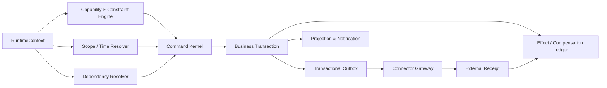

# Stage 可组合后端框架：权限、业务、时间与空间

本文提出 Stage 的通用后端内核：让同一套业务命令能够在不同岗位、任务、组织空间、时间窗口和 Agent 委托下安全复用，而不把权限判断散落在业务代码中。

本文承接[z-pool 参考实现分析](reference-z-pool.md)、[Stage 组织运行架构](architecture.md)和先前会话中的岗位自治、分派/申请/直接领取、承诺、临时授权、接管与知识沉淀讨论。它是设计提案，不是已实现的权限服务、策略语言或运行时。

论文《A Programming Paradigm for Spatiotemporal Composability》提出两个互相独立的维度：组件对共享环境的影响应可撤回，组件之间的依赖应能声明并随环境变化重新解析；论文用可逆 effect、响应式 coeffect 和统一 context 来表达这两点，并在 Cordis 中实现了组件加载、配置协调和热替换（见 [arXiv:2608.25512](https://arxiv.org/abs/2608.25512)）。Stage 借用这种“上下文是契约”的思想，但把它落到组织权限、业务命令、时间有效性、数据范围和外部副作用上。

## 1. 设计目标

Stage 的后端内核需要同时回答四个问题：

| 维度 | 要回答的问题 | 首版可组合原语 |
|---|---|---|
| 权限 | 谁以什么身份，凭什么能力，能对什么对象做什么？ | `Principal`、`RoleAssignment`、`Delegation`、`Capability`、`Constraint` |
| 业务 | 这次动作属于什么业务对象，必须保持哪些不变式？ | `Command`、`WorkItem`、`Commitment`、`Delivery`、`Acceptance` |
| 时间 | 权限、承诺、版本、租约和依赖何时有效？ | `ValidityInterval`、`Lease`、`ObjectVersion`、`PolicyRelease` |
| 空间 | 作用于哪个组织、部门、项目、仓、数据域、记录或字段？依赖哪些提供者？ | `Scope`、`ResourceSelector`、`ContextKey`、`Provider`、`Dependency` |

目标不是让任意动作都自动成功，而是让动作在**不同上下文中复用同一命令实现**，同时保留可解释的拒绝、待决、未知和补偿状态。

## 2. 统一上下文：每次动作都带一份可核验的契约

所有业务命令、Agent 运行和连接器调用都通过 `RuntimeContext` 执行。组件不能从全局变量、会话文字或隐式管理员身份取得额外权限。

```yaml
context_id: ctx_...
request:
  request_id: req_...
  idempotency_key: claim:work-123:slot-1:req-456
  causation_id: event_...
subject:
  member_id: member_...
  acting_role_assignment_id: role_assignment_...
  agent_id: agent_...
  delegation_id: delegation_...
business:
  command: task.commit.create
  object_ref: work_item:work-123
  object_version: 7
  commitment_ref: null
space:
  organization_scope: org:acme
  data_scopes: [department:engineering, repository:scorebook-core]
  resource_scopes: [work_item:work-123, gitlab_project:42]
  classification_ceiling: internal
time:
  evaluated_at: 2026-10-19T10:00:00Z
  valid_until: 2026-10-19T12:00:00Z
  lease_id: lease_...
policy:
  policy_release_id: policy:2026-10-19.3
  schema_version: 1
dependencies:
  provider_bindings: [gitlab-mr@1, stage-task@1]
provenance:
  source_refs: [scorebook:commit:abc123]
```

上下文由 Stage 解析和签发，组件只能拿到与任务、数据分类和当前读者相符的派生上下文。上下文不是永久 token；它必须能过期、撤销、重新计算和审计。

## 3. 权限模型：能力组合加约束，不把角色写进业务分支

### 3.1 能力的最小结构

一条有效能力至少由以下部分组成：

```text
Capability =
  subject_selector
  × action
  × resource_selector
  × space_scope
  × validity_interval
  × conditions
  × provenance
```

示例：

```text
subject: member:alice / role_assignment:engineering-owner
action:  task.delivery.submit
resource: work_item:work-123 / repository:scorebook-core
space:   organization:acme / department:engineering
time:    2026-10-19T09:00Z..2026-10-19T17:00Z
condition: task.version == 7 && classification <= internal
source:   delegation:del-42 + policy:2026-10-19.3
```

### 3.2 借鉴 z-pool 的授权原则

z-pool 将全局角色和主体成员档位作为两个来源，权限采用清楚的并集；业务只使用权限点，不直接判断角色名，职责分离冲突另作约束和留痕。Stage 延续这个方向：

- 基础授权以**能力点的正向组合**为主；多个有效来源不会通过隐藏规则互相抵消。
- SoD、双人规则、数据分类、对象版本、风险等级、时间失效和依赖状态作为显式 `Constraint`，不伪装成角色扣除。
- 业务命令只声明所需能力，例如 `task.commit.create`、`task.delivery.submit`、`access.grant.revoke`；不写 `if role == admin`。
- Agent 委托、岗位任职和资源权限分别建模；Agent 能代为执行某个任务，不代表继承员工的全部权限。
- 兼岗权限不自动合并。有效授权计算明确指定成员、任职、Agent/委托、任务、数据域和策略版本。

首版不引入任意 deny 优先级语言。若必须阻断，使用带原因、来源、有效期和审计引用的显式约束，避免策略组合出现不可解释的“后写 deny 覆盖先写 allow”。

### 3.3 决策结果不是布尔值

授权决策至少区分：

```text
allowed          已满足能力和约束，可以进入业务命令
denied           明确不允许，给出缺失能力或触发约束
needs_approval   能力存在，但需要特定人或双人规则批准
needs_delegation 代表关系或临时跨岗委托尚未成立
expired          过去曾有效，但当前时间窗口已结束
unknown          依赖、ACL、版本或外部回执无法核验
```

`unknown` 不自动转成 `denied` 或 `allowed`；高影响动作需要人工或连接器对账，低风险查询可以按企业策略降级为不可用。

## 4. 业务命令：权限只是前置条件，业务不变式仍要单独检查

业务组件通过声明式 `CommandSpec` 注册，而不是在每个 API handler 里自由拼接权限：

```yaml
command: task.commit.create
target_type: work_item
required_capabilities:
  - task.commit.create
preconditions:
  - work_item.version == context.object_version
  - work_item.claim_slot.available == true
  - subject.qualification.satisfies(work_item.requirements)
  - capacity.remaining >= work_item.capacity_cost
effects:
  - create: commitment
  - reserve: capacity
  - append: domain_event
  - enqueue: notification
compensation:
  - release: capacity
  - close: commitment
```

业务命令的执行顺序固定为：

```text
解析 RuntimeContext
→ 计算有效能力与约束
→ 锁定/读取目标对象的当前版本
→ 检查业务前置条件
→ 在一个业务事务中写入状态、版本、事件和 outbox
→ 返回明确结果
```

以直接领取为例，必须一次性核验任务版本、领取资格、有效委托、容量、风险、当前授权和是否已被其他人承接，同时创建 `Commitment`、`CapacityReservation` 和事件。失败不产生半份承诺；重复请求返回同一结果；参数不同的同一幂等键返回冲突。

## 5. 时间组合：有效期、版本、租约与撤销

时间不是一个 `created_at` 字段，而是多个互相独立的时间约束：

| 时间对象 | 作用 |
|---|---|
| `ValidityInterval` | 授权、委托、策略、岗位任职和任务承诺何时有效 |
| `ObjectVersion` | 业务对象或批准参数是哪一版 |
| `Lease` | 并发槽、Agent 运行、临时接管和排队动作的租约 |
| `ActivationWindow` | ScoreBook 发布清单或规则包何时可以加载 |
| `ObservedAt` | 外部 ACL、回执、投影和缓存最后一次被核验的时间 |

每次执行重新检查当前时间、租约、撤销和对象版本。运行开始时通过，不代表运行到一半仍然有权限；高影响长运行需要续租或分段核验。

### 5.1 效果的可逆性分级

论文把可逆 effect 建立在“每个上下文变化都有可用逆操作”的前提上；同时指出系统边界决定哪些位置能被追踪和恢复，边界外的发送等操作不能直接获得同样保证（见 [arXiv:2608.25512](https://arxiv.org/abs/2608.25512)）。Stage 不把所有外部副作用假设成可逆，而是明确分级：

```text
transactional   同一事务内可回滚，例如状态、容量、授权记录
revertible      有确定逆操作，例如释放租约、撤销订阅、卸载组件
compensatable   只能用新动作补偿，例如发出错误通知后发送更正
irreversible    无法撤回，例如已发送邮件、外部付款、已下载副本
unknown         已发出但无法确认结果，必须先对账
```

每个 effect 记录：`effect_id`、所属组件/命令、作用域、前后版本、逆操作或补偿动作、执行者、时间、结果和未知原因。组件卸载或授权撤销时，只能自动处理可安全逆转的部分；不可逆部分生成补偿任务和人工待决项。

## 6. 空间组合：组织范围、数据范围与依赖拓扑

### 6.1 类型化空间范围

空间范围不能只用一串路径或一个部门名。首版至少区分：

```text
organization      公司/租户
org_unit           部门、团队、项目
role_scope         岗位责任范围
repository        GitLab 项目、分支、路径
resource          任务、客户、合同、记录
field             字段级数据范围
environment       dev / staging / production
classification    public / internal / restricted / locked
region            地区或合规边界
```

每种 scope 有自己的继承和交集规则。`department:engineering` 不自动意味着能读取 `finance`；拥有任务编辑权不自动意味着能读取任务附件中的受限原文。查询、搜索、标题、聚合、缓存、日志和导出都继承来源空间的读者边界。

### 6.2 Context key 与组件依赖

受控组件不直接访问全局服务，而是声明自己需要的上下文键和版本：

```text
component: knowledge-publisher@1
requires:
  - task-context.v1 (read, internal)
  - repository-mr.v1 (propose, scorebook/engineering)
  - acceptance-evidence.v1 (read, task scope)
provides:
  - knowledge-candidate.v1
effects:
  - create-mr (compensatable)
```

键必须命名空间化并带接口版本，例如 `stage.gitlab.repository-mr@1`，不能只用 `mr` 这种容易冲突的名字。提供者变化时，Stage 做兼容性检查；不兼容的消费者进入 `waiting_dependency` 或 `draining`，不继续执行旧接口。

### 6.3 依赖图的激活与撤销

组件生命周期建议为：

```text
declared
→ waiting_dependency
→ active
→ draining
→ deactivated
→ retired / failed
```

提供者出现、消失、版本变化或权限收窄时，依赖解析器只重新激活受影响的组件。撤销提供者前，先停止新请求、处理或取消在途运行，再按 effect 的逆序释放可逆资源。双向依赖拆成“核心能力 + 请求中介 + 策略管理”等单向集成组件，避免把权限服务和业务服务绑成不可加载的环。

论文也提醒，依赖只按名称匹配会产生接口漂移和 key collision；Stage 的 `ContextKey` 必须有命名空间、版本范围和结构化兼容检查，不能只比较字符串是否存在。Stage 将此作为工程约束，而不是直接声称论文已经解决企业权限模型。

## 7. 运行时架构



建议拆成以下逻辑模块；首版可以部署在一个后端内：

1. **Context Kernel**：构造、裁剪、签发、续租和撤销运行上下文。
2. **Capability Engine**：合并能力来源、执行约束、产生可解释决策。
3. **Scope/Time Resolver**：解析组织、数据、资源、版本、有效期和租约。
4. **Dependency Resolver**：管理提供者、消费者、接口版本和组件生命周期。
5. **Command Kernel**：统一执行前置条件、业务事务、版本冲突和幂等。
6. **Effect Ledger**：记录可回滚、可补偿、不可逆和未知副作用。
7. **Outbox/Connector Gateway**：异步执行 GitLab、邮件、业务系统和 Agent 工具调用，并核对回执。
8. **Projection Layer**：按读者生成看板、搜索、通知和上下文包，不形成第二套可写权威。

论文讨论的动态组件组合也要求处理依赖变化和运行时协调（见 [arXiv:2608.25512](https://arxiv.org/abs/2608.25512)）；Stage 的跨进程连接器因此不能把外部调用伪装成一定成功的本地函数。

## 8. 一个完整例子：工程 Agent 提交知识 MR

场景：工程岗位 Agent 为已验收的内部服务任务整理 SOP，并向工程 ScoreBook 仓提交 MR。

1. `RuntimeContext` 绑定员工、工程任职、Agent 委托、任务版本、知识候选、工程仓和 `internal` 分类。
2. Capability Engine 判断 `knowledge.candidate.create` 与 `repository.mr.propose`，不授予 `repository.merge`。
3. Scope/Time Resolver 确认 Agent 只能读取该任务授权上下文和工程仓指定路径，委托在 30 分钟后过期。
4. Dependency Resolver 检查 `task-context.v1`、`acceptance-evidence.v1`、`repository-mr.v1` 均可用。
5. Command Kernel 读取准确验收版本，创建知识候选和 MR 请求，写入审计与 outbox。
6. GitLab connector 创建分支/MR，返回项目、分支、MR、commit 和状态；Stage 记录 `proposed`，不写成 `merged`。
7. 人类责任岗位审阅并合并后，Stage 再核验真实 commit；知识仍需按企业规则发布，GitLab 合并不自动代表 ScoreBook 已生效。
8. Agent 委托到期后，新的写入请求被拒绝；已创建 MR 是否关闭属于单独的补偿策略，不能凭撤销委托伪称外部 MR 已消失。

## 9. z-pool 与论文合并后的首版不变量

- 权限来源可以组合，业务代码不判断角色；最终能力必须带任务、空间、时间和策略版本。
- 业务命令是唯一修改业务对象的入口；查询、投影和 Agent 文字不能直接改事实。
- 请求、申请、承诺、授权、交付和验收分别建模；一种状态不能替代另一种状态。
- 所有高影响 effect 都有逆操作、补偿动作或明确的不可逆/未知标记。
- 组件只能访问声明的 context key 和空间范围；未声明依赖不能通过全局对象绕过。
- 外部系统权限、回执和实际执行仍以外部系统为准；Stage 保存期望、请求、核验和漂移状态。
- 对象版本、策略版本、接口版本和租约一起参与执行前检查。
- 撤销先阻止新动作，再处理在途和可逆资源；不能用旧发布恢复已撤销授权。
- 投影、索引、缓存、审计和接管包继承来源读权限；可审计不等于全员可读。
- `unknown`、`needs_approval`、`needs_delegation` 和 `waiting_dependency` 不得静默转换为成功。

## 10. 首版实现边界

首版先实现一个可验证的内核切片，不试图完成通用策略编程语言：

1. 固定 `RuntimeContext`、`CapabilityDecision`、`CommandSpec`、`EffectRecord`、`ContextKey` 的最小 schema。
2. 实现正向能力组合、显式约束、组织/数据/资源 scope、有效期和租约。
3. 实现 `ClaimWork`、`SubmitDelivery`、`CreateKnowledgeCandidate` 三个命令。
4. 实现数据库事务、唯一幂等键、对象版本和事务 outbox。
5. 实现一个 GitLab MR connector 和一个虚构内部服务 connector，覆盖成功、拒绝、撤销、超时未知和补偿。
6. 实现依赖等待/激活/排空/撤销状态，不做任意代码热加载。
7. 用并发领取、跨部门读取、过期委托、接口版本不兼容、外部未知回执和接管场景验收。

首版明确不承诺：任意外部副作用完整回滚、跨多个外部系统的原子事务、自动把所有自然语言政策编译成权限、无沙箱运行不可信 Agent、或通过一个全局管理员身份解决所有空间隔离。

## 11. 待决问题

- 能力点、scope、ContextKey 和 CommandSpec 的 schema 是否采用 YAML/JSON Schema、Protobuf 或数据库元数据。
- 权限约束的表达范围：首版固定约束集合，还是提供有限 DSL。
- 组织空间与外部 IdP/人事系统的字段权威和同步方向。
- 运行时上下文的签发、续租、缓存和撤销传播延迟。
- 哪些外部连接器可以提供可核验幂等，哪些只能进入 unknown/compensation。
- Agent 沙箱、工具网关和跨进程桥的部署边界。
- 多策略版本并存、发布清单激活和回退时的依赖重解析。

以上问题在技术栈、企业试点范围和真实连接器可用性明确后再定，不把论文中的形式化保证直接当作 Stage 已具备的产品保证。

## 参考

- [Stage 组织运行与热协作架构](architecture.md)
- [z-pool 参考实现分析](reference-z-pool.md)
- [ScoreBook 仓库初始化、授权与持续演进设计](../ScoreBook/docs/repository-lifecycle-design.md)
- [A Programming Paradigm for Spatiotemporal Composability](https://arxiv.org/abs/2608.25512)
