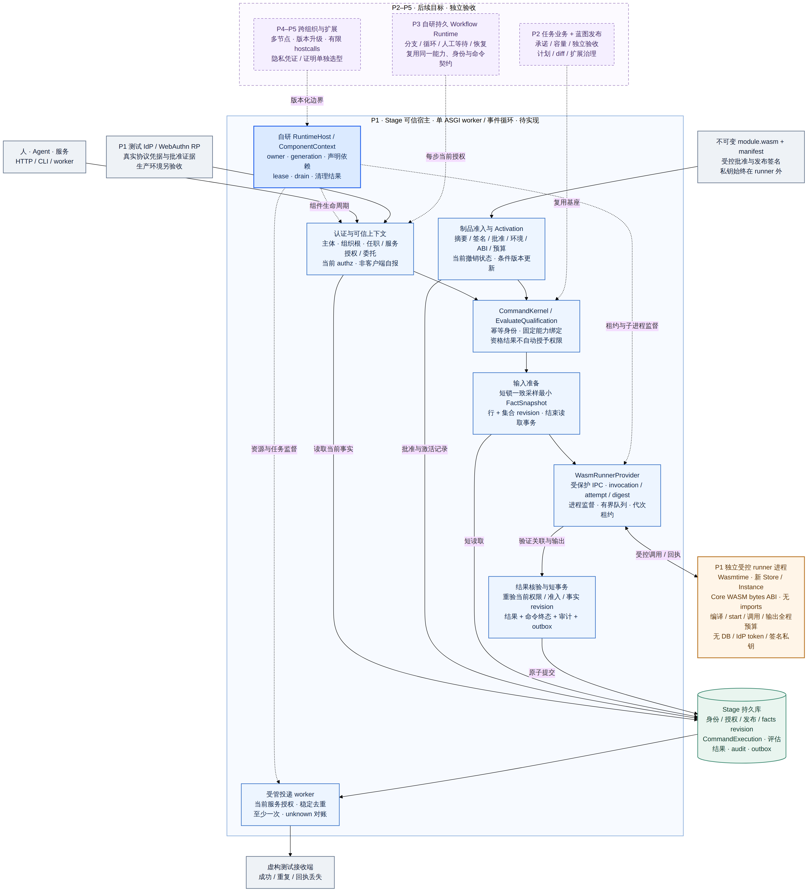

# Stage 设计与实施入口

OrchestraCorp 的长期愿景是 **AI 驱动、安全可靠的分布式工作协作平台**。Stage 用 Python 自研可信运行底座：参考 Cordis 建立组件内核，未来业务流程运行器共享能力、身份、版本和执行契约。Graphon / Dify 仅作为研究参考，不作为产品依赖。第一期优先贯通 **Core＋真实身份认证与当前授权＋受控 WASM＋最小签名准入**，用资格评估命令验证共同基座；完整任务闭环保留到后续业务切片。

设计与实现按阶段区分。当前 P1a 的 Core、生命周期和应用装配已实现，真实服务全套 324 项测试通过，34 C＋12 S 的映射验收 46/46；详见[P1a 验证](reviews/p1a-validation-2026-10-25.md)和[代码架构复查](reviews/code-architecture-review-2026-10-25.md)。真实身份、WASM、签名准入和企业业务仍待后续阶段。

2026-10-25 用户确定 **PostgreSQL＋Redis** 长期存储组合，本轮采用 PostgreSQL 17 / Redis 8 工程基线；PostgreSQL 是唯一主库，Redis 是可重建缓存/非权威短期协调/可丢失唤醒。新[存储策略](storage-strategy.md)取代早期 MySQL 默认与双库兼容要求；历史迁移和验证记录继续保留原范围。

## 阅读顺序

当前代码的实现范围、可复现问题和下一步接入约束见[代码与设计对齐审查（2026-10-24）](reviews/code-design-alignment-2026-10-24.md)，基于提交 `eb11e43` 在云开发设备重新运行检查。

| 文档 | 回答的问题 |
|---|---|
| [愿景与自研运行时方向](vision-and-runtime-direction.md) | OrchestraCorp 的目标；Stage 自研范围；可验证分布式组织怎样分阶段建设 |
| [本轮核对与表达修正](design-review-2026-10-24.md) | 哪些方向已确认，哪些是待评审方案，哪些早期概念需要纠正 |
| [目标架构](architecture.md) | 组件如何装配；请求怎样执行；运行时与业务事务的边界在哪里 |
| [当前代码架构与 Cordis 对照](current-code-architecture.md) | 当前模块关系图、默认装配范围、Cordis 共享机制与 Stage 差异 |
| [一期基础框架实施规格](framework-foundation.md) | P1a 公共接口、owner/依赖图、停止与排空、事件调用保护、provider 接入及 12 个补充边界场景 |
| [Live Smoke Tests](../tests/smoke/README.md) | 对运行中的 Stage 做只读健康、就绪、并发、OpenAPI、PostgreSQL 和 Redis 冒烟检查 |
| [PostgreSQL 与 Redis 存储策略](storage-strategy.md) | 2026-10-25 选型；主库权威、缓存撤权、故障与事务边界；历史 MySQL 退出支持 |
| [第一期范围与验收](phase-1.md) | 第一阶段具体交付什么、默认规则是什么、怎样判断完成 |
| [核心对象与契约](core-object-contracts.md) | 能力、身份、命令结果、流程实例、发布清单的关系和权威边界 |
| [身份认证与授权](identity-and-authorization.md) | 真实协议、主体映射、任职/委托、当前授权、Passkey批准和撤销 |
| [P1b 实施入口](p1b-implementation-entry.md) | 身份管理、认证与授权的起步切片、现有代码接缝、最少待决项及 Maestro 联调边界 |
| [WASM 宿主与隔离执行](wasm-host-design.md) | 固定ABI、独立runner、制品准入、全过程预算和业务提交边界 |
| [后续任务业务切片](business-slice-plan.md) | 基座完成后的任务、承诺、容量、交付与独立验收设计 |
| [长期目标与演进路线](roadmap.md) | Loader、配置协调、工作流、多进程和代码更新怎样逐步实现 |
| [Runtime 一致性工作规格](runtime-conformance.md) | “符合 Cordis 思路”具体指哪些行为；与参考实现有什么差别 |
| [调研依据与设计决策](research.md) | 论文、DSH 源码和 Python 官方文档提供了哪些证据；哪些仍未证明 |
| [Dify 工作流编排对照](dify-workflow-study.md) | 可视蓝图、节点目录、发布快照与暂停恢复如何实现；哪些机制适合 Stage |
| [Stage 与 Z Pool 架构对照](z-pool-architecture-comparison.md) | 当前源码有哪些继承与差异；设计目标与实际实现差距有多大 |
| [Z Pool 工程能力复用范围](z-pool-reuse-plan.md) | 哪些P1基础应继续使用、定向提炼或重新设计，以及对应验收条件 |
| [架构图源文件与导出](diagrams/README.md) | 可编辑 Mermaid、SVG 和 PNG 的位置及生成方式 |

## 架构图

图中蓝色区域是一期待建设范围，紫色虚线区域是后续目标。图不是当前代码部署图；当前实现以[现状基线](research.md#current-baseline)为准。

## 本轮确定的设计方向

1. 保留 Python 3.12、FastAPI、SQLAlchemy async、Alembic 及现有授权规则，新增独立 `app/runtime/`。
2. 用 `ComponentContext` 管组件依赖和资源，用 `ExecutionContext` 管每次业务动作；现有 `AuthorizationContext` 是后者的可信授权输入投影。
3. 一期采用受信任的固定Python组件组合＋受控WASM子进程；Core支持程序化服务启停和依赖换代。WASM只允许经准入的有限纯计算模块，不提供通用插件上传或在线源码HMR。
4. 评估结果、命令终态、审计和outbox同事务；后续任务业务复用这一约束。计算不持有业务锁，提交前重验当前权限、制品及事实版本。
5. Cordis 对齐采用固定参考版本、逐场景对照和公开偏差。`stage-runtime-core-v1` 是 Stage 工作规格，不是官方认证。
6. 一期必须验证真实协议adapter与隔离测试IdP，fixture仅作辅具；开发签名根和虚构数据不能代替生产身份、密钥、隔离和运维验收。
7. 自研组件内核与持久流程运行器，共享能力定义、身份、版本和结果契约；分别管理运行资源与业务实例。分布式组织不以区块链为前提，多节点部署按阶段验收。
8. PostgreSQL 17 保存当前授权、幂等、审计/outbox、业务租约和业务事实；Redis 8 只辅助，清空不丢事实，不承诺跨库双写原子性，缓存不得绕过当前撤权。SQLite 仅快测，MySQL 不再是受支持生产配置。

## 与已有文档的关系

本目录是后续实现的统一设计入口。2026-10-24 主题权威见[核对记录](design-review-2026-10-24.md)，2026-10-25 的[存储策略](storage-strategy.md)与[框架实施规格](framework-foundation.md)分别更新存储和 P1a 细节；整个一期范围以 phase-1 为准，对象、身份、WASM 由专项规格细化。早期提案或聊天中冲突的表达不继续作为实现依据。这不改变 [AGENT.md](../AGENT.md) 中的权威与安全边界。

当前实现证据：[P1a 验证](reviews/p1a-validation-2026-10-25.md)；历史[内部执行基座记录](reviews/implementation-validation-2026-10-24.json)保留当时范围。RuntimeHost 和系统 HTTP 已接入，业务 HTTP、真实身份和 WASM 仍待后续阶段。

- [组织运行架构初稿](../architecture.md)：继续提供组织责任与六个能力域的背景。
- [可组合后端提案](../composable-runtime-design.md)：第 2 节统一 RuntimeContext 和第 5.1 节混合 effect 分类由本目录的双上下文、运行资源 / 持久业务副作用分层细化替代。
- [OA 组合策略](../composition-strategy.md)：保留“预建能力＋声明式组合＋受控扩展”的方向，具体交付顺序以本目录为准。
- [授权模型设计](../authorization-model-design.md)：保留 RBAC / ReBAC / ABAC 方向；一期明确追加可信加载、租户过滤与禁止自审。
- [2026-10-19 框架审查记录](framework-review-2026-10-19.md)：保留为历史证据，不把其中的底板测试误记为新 runtime 已验收。

早期设计与图表验证不计实现验收；当前内部执行代码与历史证据保留各自范围。本轮 PostgreSQL/Redis 配置、客户端工厂及真库检查见[存储切换验证](reviews/storage-switch-validation-2026-10-25.md)，不代表 Runtime Core、真实身份、WASM 或业务接入已经完成。生产身份提供方、具体部署目标和容量业务口径仍需按[待决事项](roadmap.md#open-decisions)确定。
