# Stage 当前代码架构与 Cordis 对照

一期产品以[人员—公司—人员](people-company-collaboration.md)为协作模型。human/service 认证分别描述人员凭据和技术来源；历史 agent 枚举与纯判定结构保留兼容，不构成独立 Agent 协作或委托需求。当前以已有 WorkItem 元数据读写验证人员路径，已有本人任职发现与组织统一登录 MFA，并按[自研认证决策](native-authentication-design.md)增加密码＋TOTP、最小 OAuth/OIDC 和本地会话管理；新发行能力不自动建立成员或授予任职。

当前部署为组织授权根专属实例：数据库只允许一个组织根和一个环境。组织根是信任与治理边界，不等同于一个法人公司；根下的集团、子公司、部门等业务组织单元以后按需建模。公开业务路由使用 `/api/v1`；`GET /api/v1/identity/me` 不接受组织选择，响应中的 `organization_ref` 来自服务端组织根。内部 `tenant_*` 字段和 guard 保留兼容，部门/项目 scope 不属于 SaaS 多租户。术语边界见[组织授权根语义](organization-root-semantics.md)。

Stage 当前是 **Python 组件运行内核＋应用装配与存储 providers＋可选原生认证发行模块＋真实身份与人员工作项入口＋授权/命令/投递底座**。它通过组件声明管理依赖与资源，通过当前人员授权和数据库事务维护业务事实；完整任务产品与 WASM 按后续阶段实施。

本轮运行时定位、能力组合边界与短期禁止事项以[运行时演进与能力组合决策](runtime-evolution-and-composition.md)为准。

这里的“自研运行时”指 Stage 的后端运行控制面，不是 Agent 会话框架。Cordis 是组件组合与生命周期机制的参考来源；Stage 的验收目标是连接器、Worker 和受控能力在故障、撤销、换代和恢复时仍保持责任、幂等、审计和版本边界。`ComponentContext` 只表示一个后端组件激活代次的依赖、资源和任务上下文，不表示当前请求、登录主体、Agent 会话或数据库事务。

Stage 的运行职责分为三层：

下表是职责模型；前两层已有当前范围实现，Workflow Runtime 及通用能力目录仍为后续目标。

| 层 | 负责什么 | 状态是否必须跨进程重启保留 |
|---|---|---|
| Component Runtime | provider、连接器、WASM runner、Worker 的依赖、owner、generation、调用租约、readiness、停止与排空 | 进程内状态可重建；已提交业务事实不归这一层管理 |
| Execution Kernel | 身份、授权、命令、Unit of Work、对象版本、幂等、审计、outbox 和外部回执 | 命令结果、attempt、审计和 outbox 必须保留在 PostgreSQL |
| Workflow Runtime | P3 之后的 run、step、attempt、等待、恢复和迁移 | 必须持久化；不能放进 Fiber、`ComponentContext` 或普通后台任务内存 |

目标上三层共享能力目录、版本和结果契约，但不共享状态所有权；当前通用目录尚未实现。拿到服务租约不等于获得业务权限，组件关闭也不会撤销已提交事实。

图描述 2026-10-26 当前工作区代码。默认 `create_app()` 通过 `ApplicationRuntime` 装配数据库、身份、本人任职发现、人员工作项 provider，以及配置后的 Redis provider；明确开启 `native_auth_enabled` 并提供固定 issuer、组织根和私有密钥文件后，另装配必需的 native-auth provider。`HumanWorkService` 持有身份和存储调用 lease，使用真实人类证据与单任职授权；原通用命令适配器、投递 authorizer/sink 仍按可信组合显式注入。此前 Keycloak 路径验收见[P1b.4 记录](reviews/p1b4-assignments-mfa-2026-10-26.md)；自研模块代码与测试已加入当前工作区，部署切换和实际客户端验收须以对应运行记录为证。

identity/self-assignments/human-work 当前均在默认 required 集合内；关闭 human-work 会使整体 `/ready` 不通过。HTTP 路由静态注册，关闭组件不会删除 URL 或更新 OpenAPI，对应请求返回 unavailable。因此 Core 程序化启停不等于产品已经支持配置化移除任意业务模块。实际新增/停用步骤见[演进决策](runtime-evolution-and-composition.md#51-新增与停用功能的开发协议)。

原生认证也采用固定静态路由：OIDC Discovery 位于 `/.well-known/openid-configuration`，授权、表单登录、交换、撤销、UserInfo 和公钥位于 `/oauth/*`；本人密码变更与 TOTP 重置位于 `/api/v1/account/*`。关闭配置时这些原生入口返回 404；开启后缺少可用 provider 则失败关闭。它服务管理员登记的 public/confidential 客户端，支持精确回调、S256 PKCE、openid/profile/offline_access、SSO/同意和确认退出。新应用默认 stage-userinfo，Stage 业务另需 stage-api 与来源准入；公开自动注册、其他 grant、跨域 SPA CORS 和通用身份联邦未开放，范围见[功能矩阵](oauth-functional-coverage.md)。根路径的协议错误采用 OAuth 格式，账户 API 沿用 Stage 的结构化错误。

登录 HTML 使用 `Referrer-Policy: same-origin`，保持 Chromium 同源表单 POST 的明确 `Origin`，仍不向跨源回调发送 Referer；协议 JSON、错误 JSON 和授权重定向继续使用 `no-referrer`。HTML 的 CSP `form-action` 仅包含 `'self'` 与服务端已验证、持久绑定的回调 origin，允许真实浏览器跟随授权后的跨源 303；不读取 POST 自报回调，不使用通配符，也不把回调 path/query 拼进 CSP。协议层仍精确校验完整注册 URI；JSON 和重定向响应自身保持严格 `'self'`。所有这些响应均禁止缓存。不能为解决浏览器提交问题而接受 `Origin: null`：服务端仍精确检查配置 issuer 的 origin、浏览器秘密 cookie 和持久请求的 CSRF 绑定。仅用 HTTP 客户端模拟表单不足以验证真实浏览器的这些行为。

可编辑图源：[stage-current-code.mmd](diagrams/stage-current-code.mmd)。实线表示调用、状态读取或数据访问；虚线表示组件装配/生命周期管理。Core 内无箭头连线表示内部协作关系。

```mermaid
flowchart TB
    HTTP["HTTP 客户端 / 运维探针"] --> API["FastAPI · app/main.py<br/>Request ID / 脱敏错误 / 静态路由"]
    API --> PROBE["/health：进程存活<br/>/ready：必需组件与依赖就绪"]
    API --> IDENTITY["GET /api/v1/identity/me<br/>身份 provider / 本组织根最小自身投影"]
    API --> ASSIGNMENTS["GET /api/v1/identity/assignments<br/>本人当前任职 / 有界候选分页"]
    API --> HUMAN_WORK["HumanWorkService · 默认装配<br/>工作项读 / 标题说明编辑 / 原 key 结果读"]
    API --> NATIVE_ROUTES["固定 OAuth/OIDC 根路由<br/>/oauth/* · /.well-known/*<br/>/api/v1/account/*"]
    API -->|lifespan| BOOT["ApplicationRuntime<br/>可信装配 / 必需与可选组件 / 启停"]

    subgraph CORE["Runtime Core · Python 标准库 / 单事件循环"]
        HOST["RuntimeHost<br/>依赖图 / 代次 / 状态 / 监督"]
        CTX["ComponentContext<br/>require / provide / realm / inject"]
        EFFECT["EffectScope<br/>资源 owner / cleanup / 失败报告"]
        CALL["CallScope<br/>调用租约 / 旧绑定保活 / drain"]
        EVENT["EventBus<br/>事件模式 / listener 调用保护"]
        HOST --- CTX
        HOST --- EFFECT
        HOST --- CALL
        HOST --- EVENT
    end

    BOOT --> HOST
    PROBE -->|读取安全状态| BOOT
    HOST -.管理.-> STORAGE["PostgreSQL provider<br/>连接池 / session factory / schema 与连接探测"]
    HOST -.管理.-> CACHE["Redis provider · 配置后装配<br/>客户端 / 有限连接与超时 / PING"]
    HOST -.管理.-> IDENTITY
    HOST -.管理.-> ASSIGNMENTS
    ASSIGNMENTS -->|真实人员证据与当前策略| IDENTITY
    ASSIGNMENTS -->|组织 guard / 当前任职角色 scope| STORAGE
    HOST -.管理.-> HUMAN_WORK
    HUMAN_WORK -->|事务外人员认证 / 固定依赖租约| IDENTITY
    HOST -.明确启用后管理.-> NATIVE["NativeAuthFacade<br/>密码＋TOTP / 发行配置 / 存储调用租约"]
    NATIVE_ROUTES --> NATIVE
    NATIVE --> CREDENTIALS["NativeCredentials<br/>绑定与恢复 / 一次性 OTP / 凭据变更 / 撤会话"]
    NATIVE --> OAUTH["NativeOAuth<br/>多客户端 / PKCE / refresh 缩权与重用检测"]
    CREDENTIALS -->|短事务 / 共同锁序 / 审计| STORAGE
    OAUTH -->|持久请求 / code / session / refresh| STORAGE
    NATIVE --> BROWSER["BrowserAuthorization / NativeLogout<br/>SSO / 同意 / 确认退出"]
    NATIVE --> SESSIONS["AccountSessions<br/>本人会话 / 应用授权撤销"]
    BROWSER --> STORAGE
    SESSIONS --> STORAGE
    OAUTH --> KEYS["部署私有密钥文件 / KeyRing<br/>签名 / 公钥发布 / 保留旧公钥轮换"]
    IDENTITY --> AUTHN["Keycloak access-token adapter<br/>事务外验签 / 有界 JWKS"]
    AUTHN --> IDP["明确登记的 Keycloak 对照来源<br/>human / workload 分开验证"]
    IDENTITY --> NATIVE_AUTHN["NativeAuthenticator<br/>固定 native profile / 本地 access JWT 验签"]
    NATIVE_AUTHN -->|已加载公钥| KEYS
    IDENTITY -->|native 账号 / 会话 / client / 凭据版本重验| STORAGE
    IDENTITY -->|锁后重验映射 / 成员 / 组织 MFA 策略| STORAGE
    ADMIN["离线受控管理 CLI<br/>bootstrap / native 安装 / 撤销 / MFA 配置"] -->|共同锁序 / 同事务 journal| STORAGE
    STORAGE --> PG[("PostgreSQL<br/>当前事实 / 命令结果 / 审计 / outbox / attempts")]
    CACHE --> REDIS[("Redis<br/>辅助存储；业务缓存尚未接入")]

    HUMAN_WORK --> KERNEL["CommandKernel / UnitOfWork<br/>幂等 / 版本 / 同事务结果＋认证授权审计"]
    KERNEL --> AUTHZ["AuthenticatedAuthorizationLoader<br/>固定证据 / 单任职 / 当前权限 / 提交前重验"]
    AUTHZ -->|锁后证据重验 · 无网络| IDENTITY

    subgraph INTERNAL["需显式装配的通用命令与投递适配器"]
        COMMAND["通用 CommandService<br/>可信命令 / loader 注入"]
        WORKER["OutboxWorker<br/>租约 / 去重 / unknown / 显式对账"]
    end

    COMMAND --> KERNEL
    HOST -.显式装配与监督.-> COMMAND
    HOST -.显式装配与监督.-> WORKER
    KERNEL -->|独立事务| STORAGE
    WORKER -->|领取 / 回执 / 状态| STORAGE
    WORKER -->|事务外投递| SINK["显式注入的 sink<br/>当前集成测试使用受控测试实现"]

    classDef core fill:#eaf2ff,stroke:#3565a8,color:#182b45;
    classDef adapter fill:#edf8f2,stroke:#4d8a68,color:#203d2b;
    classDef internal fill:#fff5e5,stroke:#b87b24,color:#51350d;
    class HOST,CTX,EFFECT,CALL,EVENT core;
    class BOOT,STORAGE,CACHE,PG,REDIS,IDENTITY,AUTHN,IDP,ADMIN,ASSIGNMENTS,HUMAN_WORK,KERNEL,AUTHZ,NATIVE_ROUTES,NATIVE,CREDENTIALS,OAUTH,KEYS,NATIVE_AUTHN,BROWSER,SESSIONS adapter;
    class COMMAND,WORKER,SINK internal;
```



## 1. 当前源码如何分工

| 代码入口 | 当前职责 |
|---|---|
| [main.py](../app/main.py)、[bootstrap/application.py](../app/bootstrap/application.py) | FastAPI lifespan、可信组合、必需/可选组件、启动与关闭、就绪投影 |
| [runtime/host.py](../app/runtime/host.py) | RuntimeHost、内部组件记录、ComponentContext、PluginHandle、ProviderHandle、CallScope；registry 和任务协调也在此文件 |
| [runtime/contracts.py](../app/runtime/contracts.py) | ServiceKey、PluginSpec、BindingIdentity、状态和报告；context.py / leases.py 是公开导出，未另建第二套状态 |
| [runtime/effects.py](../app/runtime/effects.py) | 资源登记、setup/cleanup、依赖释放顺序、共享关闭与错误记录 |
| [runtime/events.py](../app/runtime/events.py) | emit、parallel、serial、bail、around waterfall，以及 listener 归属与在途 pin |
| [providers/storage.py](../app/providers/storage.py) | PG/Redis 资源创建、连接预算、schema 检查、健康探测与 availability 通知 |
| [providers/identity.py](../app/providers/identity.py)、[api/identity.py](../app/api/identity.py) | 身份 provider 生命周期、存储调用租约与最小自身投影 API；凭据/身份不进入 Core |
| [identity/authentication.py](../app/identity/authentication.py)、[identity/service.py](../app/identity/service.py) | 固定 profile 验签、企业来源准入、当前主体/成员/workload 重验；网络不占数据库锁 |
| [providers/native_auth.py](../app/providers/native_auth.py)、[api/native_auth.py](../app/api/native_auth.py) | 原生发行模块与有界存储租约；静态 OAuth/OIDC、CSRF 绑定的密码/TOTP 表单与本人账户安全 API |
| [native_auth/credentials.py](../app/native_auth/credentials.py)、[native_auth/crypto.py](../app/native_auth/crypto.py) | Argon2id、有界密码计算、加密 TOTP、单次恢复码、持久限流、凭据变更与会话撤销 |
| [native_auth/oauth.py](../app/native_auth/oauth.py)、[native_auth/keys.py](../app/native_auth/keys.py) | 持久登录请求、授权码＋PKCE、refresh 轮换/重用检测、有限寿命 access/ID token、私有文件签名与公钥轮换 |
| [identity/native.py](../app/identity/native.py)、[models/native_auth.py](../app/models/native_auth.py) | 原生 profile 的凭据适配；现有身份锁序下重验本地账号、会话、客户端和凭据版本；11 张认证事实表 |
| [native_auth/administration.py](../app/native_auth/administration.py)、[scripts/native_auth_admin.py](../scripts/native_auth_admin.py) | 操作者显式安装客户端、来源/profile 和既有 HUMAN 的账号关联；不自动建立成员经历或任职 |
| [identity/administration.py](../app/identity/administration.py) | 离线 dev/test 初始化、版本化撤销、同事务 journal 和未知结果恢复，无 HTTP 管理后门 |
| [providers/assignments.py](../app/providers/assignments.py)、[api/assignments.py](../app/api/assignments.py)、[authz/assignments.py](../app/authz/assignments.py) | 本人有效任职选择；固定成员经历、角色摘要与 scope 校验；分页结果不是权限票据 |
| [identity/assurance.py](../app/identity/assurance.py)、[identity/assurance_administration.py](../app/identity/assurance_administration.py) | 组织统一 human 强度/新鲜度策略；离线版本化配置、epoch、原子 journal 与结果恢复 |
| [authz/loader.py](../app/authz/loader.py)、[authz/administration.py](../app/authz/administration.py) | 当前 HUMAN 单任职、成员经历、固定角色版本、scope/WorkItem/direct ACL 的数据库 loader；离线 dev/test 安装与五类撤销 |
| [authz/authenticated.py](../app/authz/authenticated.py)、[identity/evidence.py](../app/identity/evidence.py) | 联合真实人员认证证据与当前单任职授权；trust/principal/组织锁序及提交前重验 |
| [providers/work.py](../app/providers/work.py)、[api/work.py](../app/api/work.py)、[features/work/details.py](../app/features/work/details.py) | 默认人员服务、三个 v1 路由与只修改标题/说明的受控 handler；原 key 恢复始终重验当前权限 |
| [providers/execution.py](../app/providers/execution.py) | 可信内部 CommandService 持存储 lease，但未接人员 identity_validator，不能直接作为公开人员入口模板；delivery plugin 管理 worker 停止、关闭与任务 |
| [execution/kernel.py](../app/execution/kernel.py)、[execution/storage.py](../app/execution/storage.py) | 版本化命令、当前授权、tenant guard、稳定幂等、事务唯一提交者、结果/审计/outbox 同事务写入 |
| [authz/decision.py](../app/authz/decision.py)、[delivery/worker.py](../app/delivery/worker.py) | 纯授权判定；数据库驱动的投递、回执和未知结果对账 |

身份服务负责真实凭据验证、当前组织成员读取以及短期 `HumanAuthenticationEvidence`。默认人员工作项 provider 在事务外认证，再由 `AuthenticatedAuthorizationLoader` 联合数据库角色/资源 loader；先取得 trust/principal 共享锁，再锁组织 guard，读取固定成员经历、单任职、角色版本、scope 和直接 ACL。最小命令只改标题/说明及版本，原角色不自动获得新 action。

人员链已接入真实认证证据的锁后与提交前重验；内部 `ExecutionContext` 由可信宿主构造，不能从 HTTP body 或 `/identity/me` 响应反序列化。业务结果、命令结果、原认证和授权审计同事务提交；元数据命令不生成 Outbox。原 key 结果查询按当前认证和读权限检查，刷新 token 不改变幂等身份。WASM、签名与完整任务业务继续后续阶段；Redis 仍无正式业务缓存/限流消费者，独立 Agent/Delegation 和通用 ServiceGrant 继续后置。

原生认证与现有身份授权保持两段职责：`NativeCredentials`/`NativeOAuth` 证明本地账号完成密码＋TOTP，发行的 access token 经 `stage.native-access.v1` profile 和外部身份映射进入同一 `Principal`/membership/assignment 链。`IdentityService` 在既有 trust→principal→组织 guard 锁序内重验原生账号、会话、client、凭据版本与期限，业务提交前再次执行；密码变更、TOTP 重置和会话撤销使用兼容的锁序，因此有效签名不能绕过本地撤销。Keycloak adapter 保留为明确登记的对照来源，是否继续准入由组织当前 profile allowlist 决定，不能凭新 issuer 自动合并账号或开放弱认证旁路。

认证请求、授权码和 refresh 的单次消费属于认证协议，不能复用业务命令的“重放旧结果”方式返回旧明文 token。refresh 重用撤销当前会话族；认证提交结果未知明确报告 unknown，由客户端重新建立安全登录流程。密码/TOTP 和账户恢复仍有各自事实与审计；具体业务的人工批准、双人规则和签名准入不由一次登录 MFA 替代。

当前应用表共 **37 张**（head `c6f3a19d820b`）：12 张身份/组织（含组织人员认证策略）、8 张角色/范围/资源/任职/关系授权表、5 张执行/投递、1 张最小 WorkItem，以及 11 张原生认证表。原生表为 `native_account`、`native_client`、`native_login_request`、`native_session`、`native_authorization_code`、`native_refresh_token`、`native_auth_event`、`native_login_throttle`、`native_browser_session`、`native_consent`、`native_logout_request`；密码摘要、加密 TOTP 和恢复码摘要与组织业务事实分表，签名私钥和 TOTP 加密主密钥位于数据库外。新授权结构使用物理 `organization_ref`；旧身份子表的 `tenant_ref` 和执行内部兼容字段继续表示唯一组织根。未映射旧授权行保留且被新 loader 排除；没有将所有目标 IAM 表预先建空表。角色内容不可变由可信注册器与摘要校验实施，当前没有数据库 trigger。原生迁移为增量，回退拒绝删除已经产生的认证事实。账号的 `totp_bootstrap_allowed` 明确区分首次密码引导与因素替换；重置响应中的一次性重绑证明只保存哈希，不能仅因种子为空就重新引导。

受信任业务模块可整体按插件边界提供服务、命令及领域规则，内部纯函数、DTO 不必逐一登记。当前 CommandKernel 构造时固定 CommandSpec 集合，通过外围组件 lease 保护在途调用，没有通用 CapabilityBinding/独立命令贡献注册表。新增公开人员功能须复用 HumanWorkService 已贯通的认证、锁协调、当前授权与提交前重验协议；通用 command_plugin 未配置身份 validator，收到含真实认证证据的上下文时会安全拒绝。

P1b.4 已实现本人任职发现和组织统一 MFA，用户选定密码＋TOTP；真实隔离 IdP、Stage HTTP/PG 和策略竞争已有证据。策略启用时，人员身份、任职和工作项入口校验精确 profile/version、ACR/AMR、auth_time 年龄；证据固定策略版本/摘要与期限，在提交前重验。迁移默认 disabled，不自动开启。新增原生模块已有首次 TOTP 绑定、一次性恢复码重新绑定、密码变更和因素重置的服务端及 HTTP 流程；不能再把这些全部列为未实现。实际 Maestro 桌面、正式人员开通/恢复操作、生产网络与运维责任仍需独立验收。历史 Keycloak 范围见[P1b.4 记录](reviews/p1b4-assignments-mfa-2026-10-26.md)，当前原生合同见[自研认证设计](native-authentication-design.md)。

### 当前生命周期策略与已知演进点

数据库 provider 的健康探测变化会通知 RuntimeHost，Host 可重协调受影响的依赖组件。这保证不可用的 provider 不继续向新调用发放租约，但“暂时不健康”和“实现或配置换代”目前共享同一条重协调路径，短暂抖动可能造成不必要的组件重建。后续应把拒绝新调用、readiness 变化、有限重试/抖动抑制和真正 replace 分开验收；在此之前不得把一次健康恢复解释为全局配置已经换代。

当前 `ctx.spawn()` 只监督进程内任务。持久 Worker 必须从 PostgreSQL outbox/attempt 领取工作并保存 lease、fencing、回执和 `unknown` 状态；重启后先按稳定幂等身份查询外部结果，再决定重试。连接器调用不在业务事务中等待，关闭顺序是停止新领取、排空在途调用、释放客户端，未决外部副作用留在持久 attempt 中。

原生认证 provider 的卸载只释放进程内服务和调用租约，不删除账号、会话或审计；重新装配从 PostgreSQL 恢复当前凭据事实。密钥配置由部署操作者控制，轮换保留仍需验证的旧公钥，并同时更新发行与身份验证所加载的配置；当前没有在线任意上传密钥或通用动态 issuer 管理入口。匿名授权请求与因素验证使用 PostgreSQL 持久限流，真实来源地址依赖受控反向代理配置；不能任意信任客户端提供的 Forwarded/X-Forwarded-For。

## 2. 我们怎样参考 Cordis

参考对象是 Maestro 中固定提交 `6f7124baabca582d43ce84fd59d2f48e4b790763` 的 DSH vendored Cordis，清单记录上游 `4.0.0-rc.7`，包含 DSH 生命周期补丁。论文提供组合思想；实际行为由固定源码与测试确认，不能将该副本当作所有 Cordis 版本的行为。

我们保留了六项核心机制：

| Cordis 机制 | Stage 的当前实现 | 具体效果 |
|---|---|---|
| effect 归属 | EffectScope、owner/generation、disposer | 谁登记监听、资源或任务，谁负责在退出时收尾 |
| coeffect / 响应式依赖 | PluginSpec.requires/provides、RuntimeHost reconcile | consumer 等待依赖；provider 可用、消失或换代时自动协调启停 |
| Context 与 committed view | ComponentContext.require、自身/祖先绑定、get 观察 | 旧 consumer 的清理继续用旧 provider，避免中途混用新实现 |
| 按服务键隔离 | isolate / realm、intercept、inject | 子作用域可换自己的 DB 实现，同时继续共享 logger 等其他服务 |
| caller ownership | 显式传入调用方 context/owner | 两组件共用服务时，A 创建的资源不会误归 B 或 provider |
| 事件组合 | 五种分发模式与显式短路 | parallel 等全部完成，waterfall 以 next 包装下游，保持原来的组合含义 |

这使组件既声明“我需要什么”，也登记“我创建了什么、怎样释放”。资源只要经过受管理入口，Core 就能持续协调其依赖和生命周期。任意 Python 副作用仍需适配器明确登记；Context 本身不是安全沙箱。

## 3. 与固定参考实现的差异

| 方面 | 固定 DSH Cordis | Stage 当前选择 |
|---|---|---|
| 语言与访问方式 | TypeScript/JavaScript，Proxy 与属性追踪 | Python asyncio，显式 require/provide/owner/call；不直接加载 TS 插件 |
| provider 关闭屏障（D-01） | provide disposer 内等待消费者；其他顶层 effect 可同时清理 | 先关闭受影响依赖闭包的新接入，再等消费者和调用结束，最后释放连接池等资源 |
| 清理顺序（D-02） | 单个 effect 内反序，Fiber 顶层并发 | 先 stop/join，满足依赖条件后同 owner 默认反序；失败依赖保留 blocked |
| 关闭与错误（D-03/04） | 公开 disposer single-shot；部分 teardown 错误以日志承接 | 并发等待共享关闭操作，等待取消不取消它；结构化 failed/blocked/pending 报告，不把超时当完成 |
| 身份与换代（D-05） | 依赖 epoch 主要由 provider Fiber UID 组成 | 分开 provider ID、activation generation、change_revision、registration_id，识别 ABA 和同代重登记 |
| Python 事件适配（D-07） | bail 依赖 JS 值语义；emit 不等待返回 Promise | Continue/Stop 显式表示短路，emit 限同步回调；parallel 聚合属于共享语义 |
| 在途事件（D-08） | 回调快照与列表注销，无相同调用租约保证 | 整个 snapshot 持有 owner/代次 pin，卸载等待在途回调，禁止会形成等待环的关闭 |
| 就绪（D-09） | fiber.await 可在缺依赖的 PENDING 状态返回 | 显式 required/deadline；区分 ready、pending、failed、timeout；提供 `/ready` |
| 应用责任 | 通用组件组合，不定义 Stage 的业务事务 | authz、UoW、审计、outbox、PG/Redis 在 Core 外实现，作为 provider/consumer 使用 Core |

例如关闭数据库时，Stage 的顺序是：

```text
停止接收依赖旧 DB 的新调用
→ 通知 consumer/worker 停止生产
→ 完成旧事务、取消记账及在途事件
→ 释放旧 binding/call pins
→ dispose engine
→ 汇总关闭结果；失败或未完成保持可观察
```

这个关闭屏障借鉴论文 Algorithm 5 的整体等待思想，业务调用租约属于 Stage 增强；默认顶层 LIFO 则是 Stage 自身选择，不能归因为论文要求。组件释放资源与数据库撤销业务是两件事：disposer 不会撤销已提交的命令、审计或外部通知。

## 4. 对齐证据与范围

2026-10-26 的 P2/P3 整改补齐了几个实际复用边界：`HumanOperations.request()` 统一人员身份/截止/租约和完整 kernel 装配，`CommandKernel.read()` 提供同事务授权与披露前重验；`app.control` 复用管理 journal/幂等/unknown，`native_auth.current_session` 独立复核会话事实。认证 HTTP 按共享安全边界、浏览器、退出、OAuth、账户分为同层模块。Runtime 成功卸载记录和 observations 有界，未完成/失败清理继续保留。它们没有增加新的插件平台、业务命令或物理表。详见[公共业务入口](protected-business-operations.md)与[整改复查](reviews/p2p3-architecture-closeout-2026-10-26.md)。

[固定参考记录](reviews/runtime-reference-2026-10-25/manifest.json)包含固定 TS 源码摘要、34 个 C 编号的参考观测、35 组同描述操作的 TS/Python 一致结果及 9 组预声明差异；覆盖关系见[coverage.json](reviews/runtime-reference-2026-10-25/coverage.json)。这些是有界行为对照，不等于全生态兼容。

Stage 自身另有[34 C＋12 S 的 Python 场景映射验收](reviews/final-architecture-conformance-2026-10-25.json)。完整实现入口、规格与边界分别见[Core README](../app/runtime/README.md)、[一致性规格](runtime-conformance.md)、[P1a 记录](reviews/p1a-validation-2026-10-25.md)。当前采用受控 Python 装配；Loader/HMR、任意在线插件装载、通用工作流和多节点运行仍属后续能力。

后续能力按阶段推进：P1 完成真实身份、受控 WASM、签名准入和 `EvaluateQualification` 纵向闭环；P2 交付有限能力目录、蓝图发布和业务切片；P3 才建设持久流程；P4 再验证多进程、多节点和 fencing；P5 只在真实消费者与威胁模型成立后扩展 WASM hostcall、WIT 或隐私协议。每一阶段都必须单独验证重启恢复、撤销竞态、版本固定、未知结果对账和关闭排空，不能用 Core 场景通过推导业务流程已经可靠。
