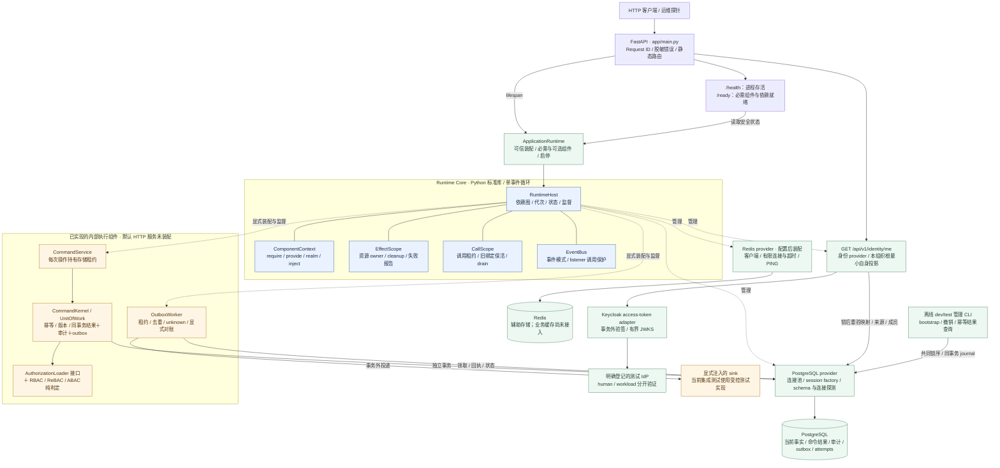

# Stage 当前代码架构与 Cordis 对照

当前部署为组织授权根专属实例：数据库只允许一个组织根和一个环境。组织根是信任与治理边界，不等同于一个法人公司；根下的集团、子公司、部门等业务组织单元以后按需建模。公开业务路由使用 `/api/v1`；`GET /api/v1/identity/me` 不接受组织选择，响应中的 `organization_ref` 来自服务端组织根。内部 `tenant_*` 字段和 guard 保留兼容，部门/项目 scope 不属于 SaaS 多租户。术语边界见[组织授权根语义](organization-root-semantics.md)。

Stage 当前是 **Python 组件运行内核＋应用装配与存储 providers＋身份读取切片＋内部命令/投递底座**。它通过组件声明管理依赖与资源，通过应用层授权和数据库事务维护业务事实。

本轮运行时定位、能力组合边界与短期禁止事项以[运行时演进与能力组合决策](runtime-evolution-and-composition.md)为准。

这里的“自研运行时”指 Stage 的后端运行控制面，不是 Agent 会话框架。Cordis 是组件组合与生命周期机制的参考来源；Stage 的验收目标是连接器、Worker 和受控能力在故障、撤销、换代和恢复时仍保持责任、幂等、审计和版本边界。`ComponentContext` 只表示一个后端组件激活代次的依赖、资源和任务上下文，不表示当前请求、登录主体、Agent 会话或数据库事务。

Stage 的运行职责分为三层：

| 层 | 负责什么 | 状态是否必须跨进程重启保留 |
|---|---|---|
| Component Runtime | provider、连接器、WASM runner、Worker 的依赖、owner、generation、调用租约、readiness、停止与排空 | 进程内状态可重建；已提交业务事实不归这一层管理 |
| Execution Kernel | 身份、授权、命令、Unit of Work、对象版本、幂等、审计、outbox 和外部回执 | 命令结果、attempt、审计和 outbox 必须保留在 PostgreSQL |
| Workflow Runtime | P3 之后的 run、step、attempt、等待、恢复和迁移 | 必须持久化；不能放进 Fiber、`ComponentContext` 或普通后台任务内存 |

三层共享能力目录、版本和结果契约，但不共享状态所有权。拿到服务租约不等于获得业务权限，组件关闭也不会撤销已提交事实。

图描述 2026-10-25 当前工作区代码。默认 `create_app()` 创建 `ApplicationRuntime(settings)`，装配数据库与身份 provider，以及配置 Redis URL 后的 Redis provider；对外提供 `/health`、`/ready`、`GET /api/v1/identity/me` 和开发 OpenAPI。身份读取须有明确 profile、真实 access token 及服务端唯一组织根的准入/成员，当前验收见[P1b 首条切片](reviews/p1b-first-slice-2026-10-25.md)。命令与投递组件仍须调用方显式提供可信 loader、authorizer、命令及 sink 才能装配，不代表业务写 API 已开放。

可编辑图源：[stage-current-code.mmd](diagrams/stage-current-code.mmd)。实线表示调用、状态读取或数据访问；虚线表示组件装配/生命周期管理。Core 内无箭头连线表示内部协作关系。



## 1. 当前源码如何分工

| 代码入口 | 当前职责 |
|---|---|
| [main.py](../app/main.py)、[bootstrap/application.py](../app/bootstrap/application.py) | FastAPI lifespan、可信组合、必需/可选组件、启动与关闭、就绪投影 |
| [runtime/host.py](../app/runtime/host.py) | RuntimeHost、内部组件记录、ComponentContext、PluginHandle、ProviderHandle、CallScope；registry 和任务协调也在此文件 |
| [runtime/contracts.py](../app/runtime/contracts.py) | ServiceKey、PluginSpec、BindingIdentity、状态和报告；context.py / leases.py 是公开导出，未另建第二套状态 |
| [runtime/effects.py](../app/runtime/effects.py) | 资源登记、setup/cleanup、依赖释放顺序、共享关闭与错误记录 |
| [runtime/events.py](../app/runtime/events.py) | emit、parallel、serial、bail、around waterfall，以及 listener 归属与在途 pin |
| [providers/storage.py](../app/providers/storage.py) | PG/Redis 资源创建、连接预算、schema 检查、健康探测与 availability 通知 |
| [providers/identity.py](../app/providers/identity.py)、[api/identity.py](../app/api/identity.py) | 身份 provider 生命周期、存储调用租约与最小自身投影 API；凭据/身份不进入 Core |
| [identity/authentication.py](../app/identity/authentication.py)、[identity/service.py](../app/identity/service.py) | 固定 profile 验签、企业来源准入、当前主体/成员/workload 重验；网络不占数据库锁 |
| [identity/administration.py](../app/identity/administration.py) | 离线 dev/test 初始化、版本化撤销、同事务 journal 和未知结果恢复，无 HTTP 管理后门 |
| [providers/execution.py](../app/providers/execution.py) | CommandService 调用全程持有存储 lease；delivery plugin 将 worker 的停止、关闭、任务挂到组件 owner |
| [execution/kernel.py](../app/execution/kernel.py)、[execution/storage.py](../app/execution/storage.py) | 版本化命令、当前授权、tenant guard、稳定幂等、事务唯一提交者、结果/审计/outbox 同事务写入 |
| [authz/decision.py](../app/authz/decision.py)、[delivery/worker.py](../app/delivery/worker.py) | 纯授权判定；数据库驱动的投递、回执和未知结果对账 |

已实现的身份 loader 只负责本组织根自身投影；完整角色版本/资源 ACL loader、ServiceGrant/Agent 委托、WASM、发布签名准入、持久业务工作流和任务业务 HTTP 继续后续实现。PG 只保存已建模事实，不表示设计文档中的完整 IAM/组织模型均已建表。Redis provider 已可运行，但应用尚无正式缓存、限流或消息消费者。

### 当前生命周期策略与已知演进点

数据库 provider 的健康探测变化会通知 RuntimeHost，Host 可重协调受影响的依赖组件。这保证不可用的 provider 不继续向新调用发放租约，但“暂时不健康”和“实现或配置换代”目前共享同一条重协调路径，短暂抖动可能造成不必要的组件重建。后续应把拒绝新调用、readiness 变化、有限重试/抖动抑制和真正 replace 分开验收；在此之前不得把一次健康恢复解释为全局配置已经换代。

当前 `ctx.spawn()` 只监督进程内任务。持久 Worker 必须从 PostgreSQL outbox/attempt 领取工作并保存 lease、fencing、回执和 `unknown` 状态；重启后先按稳定幂等身份查询外部结果，再决定重试。连接器调用不在业务事务中等待，关闭顺序是停止新领取、排空在途调用、释放客户端，未决外部副作用留在持久 attempt 中。

## 2. 我们怎样参考 Cordis

参考对象是 Maestro 中固定提交 `6f7124baabca582d43ce84fd59d2f48e4b790763` 的 DSH vendored Cordis，清单记录上游 `4.0.0-rc.7`，包含 DSH 生命周期补丁。论文提供组合思想；实际行为由固定源码与测试确认，不能将该副本当作所有 Cordis 版本的行为。

我们保留了六项核心机制：

| Cordis 机制 | Stage 的当前实现 | 具体效果 |
|---|---|---|
| effect 归属 | EffectScope、owner/generation、disposer | 谁登记监听、资源或任务，谁负责在退出时收尾 |
| coeffect / 响应式依赖 | PluginSpec.requires/provides、RuntimeHost reconcile | consumer 等待依赖；provider 可用、消失或换代时自动协调启停 |
| Context 与 committed view | ComponentContext.require、自身/祖先绑定、get 观察 | 旧 consumer 的清理继续用旧 provider，避免中途混用新实现 |
| 按服务键隔离 | isolate / realm、intercept、inject | 子作用域可换自己的 DB 实现，同时继续共享 logger 等其他服务 |
| caller ownership | 显式传入调用方 context/owner | 两组件共用服务时，A 创建的资源不会误归 B 或 provider |
| 事件组合 | 五种分发模式与显式短路 | parallel 等全部完成，waterfall 以 next 包装下游，保持原来的组合含义 |

这使组件既声明“我需要什么”，也登记“我创建了什么、怎样释放”。资源只要经过受管理入口，Core 就能持续协调其依赖和生命周期。任意 Python 副作用仍需适配器明确登记；Context 本身不是安全沙箱。

## 3. 与固定参考实现的差异

| 方面 | 固定 DSH Cordis | Stage 当前选择 |
|---|---|---|
| 语言与访问方式 | TypeScript/JavaScript，Proxy 与属性追踪 | Python asyncio，显式 require/provide/owner/call；不直接加载 TS 插件 |
| provider 关闭屏障（D-01） | provide disposer 内等待消费者；其他顶层 effect 可同时清理 | 先关闭受影响依赖闭包的新接入，再等消费者和调用结束，最后释放连接池等资源 |
| 清理顺序（D-02） | 单个 effect 内反序，Fiber 顶层并发 | 先 stop/join，满足依赖条件后同 owner 默认反序；失败依赖保留 blocked |
| 关闭与错误（D-03/04） | 公开 disposer single-shot；部分 teardown 错误以日志承接 | 并发等待共享关闭操作，等待取消不取消它；结构化 failed/blocked/pending 报告，不把超时当完成 |
| 身份与换代（D-05） | 依赖 epoch 主要由 provider Fiber UID 组成 | 分开 provider ID、activation generation、change_revision、registration_id，识别 ABA 和同代重登记 |
| Python 事件适配（D-07） | bail 依赖 JS 值语义；emit 不等待返回 Promise | Continue/Stop 显式表示短路，emit 限同步回调；parallel 聚合属于共享语义 |
| 在途事件（D-08） | 回调快照与列表注销，无相同调用租约保证 | 整个 snapshot 持有 owner/代次 pin，卸载等待在途回调，禁止会形成等待环的关闭 |
| 就绪（D-09） | fiber.await 可在缺依赖的 PENDING 状态返回 | 显式 required/deadline；区分 ready、pending、failed、timeout；提供 `/ready` |
| 应用责任 | 通用组件组合，不定义 Stage 的业务事务 | authz、UoW、审计、outbox、PG/Redis 在 Core 外实现，作为 provider/consumer 使用 Core |

例如关闭数据库时，Stage 的顺序是：

```text
停止接收依赖旧 DB 的新调用
→ 通知 consumer/worker 停止生产
→ 完成旧事务、取消记账及在途事件
→ 释放旧 binding/call pins
→ dispose engine
→ 汇总关闭结果；失败或未完成保持可观察
```

这个关闭屏障借鉴论文 Algorithm 5 的整体等待思想，业务调用租约属于 Stage 增强；默认顶层 LIFO 则是 Stage 自身选择，不能归因为论文要求。组件释放资源与数据库撤销业务是两件事：disposer 不会撤销已提交的命令、审计或外部通知。

## 4. 对齐证据与范围

[固定参考记录](reviews/runtime-reference-2026-10-25/manifest.json)包含固定 TS 源码摘要、34 个 C 编号的参考观测、35 组同描述操作的 TS/Python 一致结果及 9 组预声明差异；覆盖关系见[coverage.json](reviews/runtime-reference-2026-10-25/coverage.json)。这些是有界行为对照，不等于全生态兼容。

Stage 自身另有[34 C＋12 S 的 Python 场景映射验收](reviews/final-architecture-conformance-2026-10-25.json)。完整实现入口、规格与边界分别见[Core README](../app/runtime/README.md)、[一致性规格](runtime-conformance.md)、[P1a 记录](reviews/p1a-validation-2026-10-25.md)。当前采用受控 Python 装配；Loader/HMR、任意在线插件装载、通用工作流和多节点运行仍属后续能力。

后续能力按阶段推进：P1 完成真实身份、受控 WASM、签名准入和 `EvaluateQualification` 纵向闭环；P2 交付有限能力目录、蓝图发布和业务切片；P3 才建设持久流程；P4 再验证多进程、多节点和 fencing；P5 只在真实消费者与威胁模型成立后扩展 WASM hostcall、WIT 或隐私协议。每一阶段都必须单独验证重启恢复、撤销竞态、版本固定、未知结果对账和关闭排空，不能用 Core 场景通过推导业务流程已经可靠。
