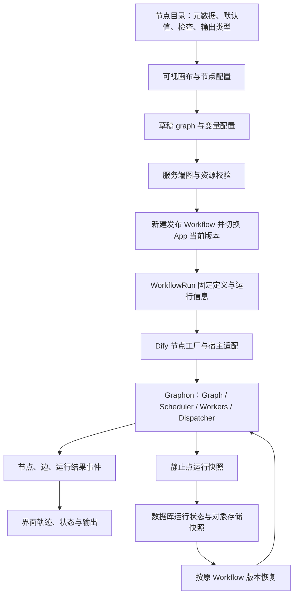

# Dify 工作流编排与 Stage 蓝图设计对照

> **固定版本的历史研究记录。** 正文实现观察与行号对应 2026-10-24 的 Dify/Graphon 提交，10-25 的补记明确标注；“当前”“已实现”描述参考项目在该版本的代码，不表示最新上游或 Stage 已交付。现行 Stage 定位、实现和阶段见[运行时演进决策](runtime-evolution-and-composition.md)、[当前代码架构](current-code-architecture.md)及[路线图](roadmap.md)。本次仅修复来源可复现性，不修改历史研究结论或验收范围。

本次按用户要求克隆 Dify，静态追踪编辑、保存、发布、执行与暂停恢复链路。结论是：Stage 值得借鉴其“图定义、节点能力目录、发布版本、运行实例、运行状态”分层，并明确保留组织授权、签名批准、业务事务和持久副作用的独立边界。本记录不是采用 Dify/Graphon 的决定，也不是运行测试报告。

2026-10-24 用户进一步明确：Stage 从初期自研与 Cordis 组件思想配合的运行时和工作规范，Graphon / Dify 只作为研究参考，不作为产品依赖。本文保留源码事实，后续建议按[自研方向](vision-and-runtime-direction.md)执行。

2026-10-25 再次确认：Dify Workflow DSL 不作为 Stage 原生执行协议。Stage 可以借鉴其草稿/发布/运行快照分层；未来如提供导入，只做单向适配到 Stage 自己的 `BlueprintSource`，再编译为经过能力、授权、scope、预算、版本和签名检查的 `CompiledPlan`/`ReleaseManifest`。不直接复用 Dify 的插件、凭据、多租户应用或 Graphon 执行语义。

这条限制由[运行时演进与能力组合决策](runtime-evolution-and-composition.md)统一维护：Dify DSL 只用于研究和发现工作流规格边界，不能直接作为 Stage 的执行、授权、发布或恢复协议，也不能把 Dify/Graphon 加入 Stage 的生产依赖。任何未来导入都必须是单向、可拒绝的适配，并重新生成 Stage 自己的能力版本、`CompositionPlan`、`Release` 和 `Activation`。

## 1. 固定研究基线

| 对象 | 本次读取版本与位置 |
|---|---|
| Dify | [官方仓库固定提交](https://github.com/langgenius/dify/tree/39d9a333619540ebc12282033f0677dcb79bc96a) `39d9a333619540ebc12282033f0677dcb79bc96a`；原研究路径 `../../dify/`，当前设备未保留 |
| Graphon | [官方仓库固定提交](https://github.com/langgenius/graphon/tree/4fa22141774dff80e90e4dfa98ea3e6fbf0421bb) `4fa22141774dff80e90e4dfa98ea3e6fbf0421bb`；Dify 声明 `graphon==0.8.0`，官方 pyproject 与 uv.lock 共同固定来源 URL 和提交 |
| Stage | 本轮只新增研究记录及入口链接，没有新增运行代码、依赖、数据库迁移或生产配置 |

依据：[Dify pyproject](https://github.com/langgenius/dify/blob/39d9a333619540ebc12282033f0677dcb79bc96a/api/pyproject.toml) 第 49、66–67 行，[uv.lock](https://github.com/langgenius/dify/blob/39d9a333619540ebc12282033f0677dcb79bc96a/api/uv.lock) 第 3090–3092 行。

当前 Dify 的执行核心已经独立为 Graphon；不能沿用旧版本 `api/core/workflow/graph_engine/` 的路径解读当前实现。`api/core/` 在仓库指令中标记为迁移区域，Dify 的集成接缝仍存在其中。

Graphon 研究时仅读取固定提交的相关源码，保存在 `../../reference-materials/graphon-4fa22141774d/`，并逐文件核对 Git blob SHA-1。该目录是选定文件的研究快照，不是完整仓库或安装环境。原本地说明 `../../reference-materials/graphon-4fa22141774d/README.md` 当前不可用，不能用上游 README 冒充该快照清单；下文源码链接已改为官方固定提交，可从上表版本入口取得相同路径。

2026-10-25 来源复核：通过固定版本 Dify `pyproject.toml` 和 `uv.lock` 确认 Graphon 来源为 `https://github.com/langgenius/graphon` 及上表提交。对本文引用的 35 个不同源文件及补充的 Graphon LICENSE 共 36 个固定版本原始文件进行只读 GET，全部返回 HTTP 200。此检查确认来源和文件可取得，不重做原研究的逐文件 blob 清单比对，也不替代任何运行验收。

验证范围：已核对源代码和版本来源，未安装依赖、启动 Dify、执行 Graphon/Dify 测试，未验证真实数据库、队列、对象存储、并发故障和恢复行为。下文“已有机制”指代码实现可定位，不表示本轮运行验收通过。

## 2. 整体链路

需要区分四个对象：编辑草稿、发布定义、某次运行实例、该次运行的快照。更改当前发布版本，不等于重新解释所有已经开始的运行。

## 3. 可视编辑与节点能力目录

### 3.1 画布与业务节点分层

前端通过 React Flow 包装组件绘制图。画布层区分普通节点、注释、循环起点等视觉容器；具体业务类型由另一层节点目录映射到编辑面板与组件。

证据：[workflow/index.tsx](https://github.com/langgenius/dify/blob/39d9a333619540ebc12282033f0677dcb79bc96a/web/app/components/workflow/index.tsx) 第 112–122 行，[workflow-canvas.tsx](https://github.com/langgenius/dify/blob/39d9a333619540ebc12282033f0677dcb79bc96a/web/app/components/workflow/shortcuts/workflow-canvas.tsx) 第 38 行，[nodes/components.ts](https://github.com/langgenius/dify/blob/39d9a333619540ebc12282033f0677dcb79bc96a/web/app/components/workflow/nodes/components.ts) 第 44 行。

`NodeDefault` 把节点元数据、默认参数、配置检查及输出变量声明组织在一起。节点目录因此既支持左侧组件选择，也支持配置面板、连线变量选择和发布前检查。见 [types.ts](https://github.com/langgenius/dify/blob/39d9a333619540ebc12282033f0677dcb79bc96a/web/app/components/workflow/types.ts) 第 372–401 行。

**Stage 建议**：建立自己的业务能力目录，每项定义稳定 ID、配置 schema、输入输出、授权要求、执行与失败语义、版本及 UI 描述。前端和后端共享可生成的契约；服务端仍是最终校验方。组织岗位选择器与业务能力点分别建模，节点出现于画布并不授予权限。

### 3.2 草稿保存不等于运行制品

Dify 在保存前清理临时节点/边和节点 `data` 中的运行态字段，采用延迟与串行保存，并发送已有草稿 hash。服务端先锁草稿行，再比较 hash，拒绝用过时草稿覆盖新的内容。

证据：[use-nodes-sync-draft.ts](https://github.com/langgenius/dify/blob/39d9a333619540ebc12282033f0677dcb79bc96a/web/app/components/workflow-app/hooks/use-nodes-sync-draft.ts) 第 70–149、204–239 行，[use-serial-async-callback.ts](https://github.com/langgenius/dify/blob/39d9a333619540ebc12282033f0677dcb79bc96a/web/app/components/workflow/hooks/use-serial-async-callback.ts) 第 14–16 行，[workflow-draft-slice.ts](https://github.com/langgenius/dify/blob/39d9a333619540ebc12282033f0677dcb79bc96a/web/app/components/workflow/store/workflow/workflow-draft-slice.ts) 第 35–37 行，[WorkflowService](https://github.com/langgenius/dify/blob/39d9a333619540ebc12282033f0677dcb79bc96a/api/services/workflow_service.py) 第 412–490 行。

该 `unique_hash` 仅从 graph 计算，作用是草稿并发控制；不是覆盖全部配置与依赖的发布摘要，更不是组织签名。见 [Workflow.unique_hash](https://github.com/langgenius/dify/blob/39d9a333619540ebc12282033f0677dcb79bc96a/api/models/workflow.py) 第 548–556 行。

**Stage 建议**：分别保存编辑布局、可执行语义、调试显示状态。发布执行计划只包含明确的执行输入；权限变化、岗位变化、规则变化要做语义 diff。布局信息可以随包保留，但不得让挪动一个图形意外改变业务意义。

### 3.3 运行事件驱动界面

Dify 在运行前同步草稿，以流式事件更新节点轨迹、边状态、变量与输出。运行回调独立于画布编辑逻辑，并包含暂停、人工输入和恢复状态处理。

证据：[use-workflow-run.ts](https://github.com/langgenius/dify/blob/39d9a333619540ebc12282033f0677dcb79bc96a/web/app/components/workflow-app/hooks/use-workflow-run.ts) 第 208、441 行，[callbacks](https://github.com/langgenius/dify/blob/39d9a333619540ebc12282033f0677dcb79bc96a/web/app/components/workflow-app/hooks/use-workflow-run-callbacks.ts) 第 172–197、260–267 行，[node-started](https://github.com/langgenius/dify/blob/39d9a333619540ebc12282033f0677dcb79bc96a/web/app/components/workflow/hooks/use-workflow-run-event/use-workflow-node-started.ts) 第 25–92 行。

Stage 应保留事件驱动回显，但 UI 取消状态要以服务端事实为准。Dify 运行 hook 第 506–531 行会在请求 stop 后更新本地停止状态，或中止本地连接；这不证明外部业务动作已取消。Stage 应区分 cancel_requested、已停止与结果未知。

## 4. DSL、发布版本与运行快照

Dify 用可读 YAML 导入/导出 DSL，包括应用信息、workflow graph、变量、features 和插件依赖。导入检查 DSL 版本；可导出指定发布版本，未指定时使用草稿。

证据：[AppDslService](https://github.com/langgenius/dify/blob/39d9a333619540ebc12282033f0677dcb79bc96a/api/services/app_dsl_service.py) 第 270–290、965–1031 行。

导出路径会处理环境绑定，例如默认移除工具 credential_id，并清理部分触发器的部署关联。它是可移植定义格式，不能直接当成已经完成环境绑定的签名执行包。具体见同文件第 1091–1120 行。

发布时 Dify 验证草稿，然后创建新的 Workflow，复制 graph、变量、features 和相关绑定，分配递增版本编号。控制器在同一数据库事务中将 App 的当前 workflow_id 切向新版本。

证据：[WorkflowService.publish_workflow](https://github.com/langgenius/dify/blob/39d9a333619540ebc12282033f0677dcb79bc96a/api/services/workflow_service.py) 第 690–785 行，[发布控制器](https://github.com/langgenius/dify/blob/39d9a333619540ebc12282033f0677dcb79bc96a/api/controllers/console/app/workflow.py) 第 1337–1365 行，[版本模型](https://github.com/langgenius/dify/blob/39d9a333619540ebc12282033f0677dcb79bc96a/api/models/workflow.py) 第 204–224 行。

WorkflowRun 保存关联的 workflow_id、version、graph、输入、输出和状态。后续应用发布不应改变既有运行绑定的定义。见 [WorkflowRun](https://github.com/langgenius/dify/blob/39d9a333619540ebc12282033f0677dcb79bc96a/api/models/workflow.py) 第 754–850 行。

**Stage 建议**：保留可读 BlueprintSource，编译出默认值已展开、依赖已锁定的 BlueprintPlan；生成带源摘要、计划摘要、能力、依赖、租户和环境的 ReleaseManifest；取得批准与签名后形成 Activation。发布计划必须携带 expected_active_revision，避免批准后执行于另一个未经比较的基线。

签名批准是 Stage 的新增治理层。所读 Dify 工作流发布/导入路径未见本次发布的 Passkey 批准、组织签名清单和执行验签协议；这不是对整个仓库所有签名功能的否定性证明。

## 5. Graphon 的图执行机制

以下源码定位均来自固定 Graphon 研究快照。

### 5.1 先验证，再实例化节点

[graph.py](https://github.com/langgenius/graphon/blob/4fa22141774dff80e90e4dfa98ea3e6fbf0421bb/src/graphon/graph/graph.py) 第 659–775 行：规范化节点/边与容器归属，预检节点 schema 和执行类型，再验证 owner、边端点与 scope 内循环，最后创建实际节点实例。

[validation.py](https://github.com/langgenius/graphon/blob/4fa22141774dff80e90e4dfa98ea3e6fbf0421bb/src/graphon/graph/validation.py) 第 46–102 行使用拓扑检查拒绝同一 scope 内的回边循环。Loop/Iteration 以专用容器实现。发布路径不能把跳过部分图校验的选项当作正常模式。

**Stage 建议**：在插件取得资源或产生外部动作之前完成预检；另加组织引用、能力范围、数据分类和业务约束。前端图检查只帮助编辑，无法替代服务端。

### 5.2 调度与事件处理分开

[engine.py](https://github.com/langgenius/graphon/blob/4fa22141774dff80e90e4dfa98ea3e6fbf0421bb/src/graphon/engine/engine.py) 第 62–174 行把 Graph、RuntimeState、执行帧、ready queue、固定 worker 池、dispatcher 与 scheduler 组合起来。节点执行结果经单 dispatcher 处理，再更新变量和边状态，决定下一批任务。

这是线程 worker 与同步 generator 协议，不能直接等同 Stage 所规划的 asyncio 组件生命周期。Dify 在 [workflow_entry.py](https://github.com/langgenius/dify/blob/39d9a333619540ebc12282033f0677dcb79bc96a/api/core/workflow/workflow_entry.py) 第 153–189 行注入节点运行依赖、执行限制和观测层，体现宿主集成与调度内核的分离。

### 5.3 分支与汇合有明确状态

[scheduler.py](https://github.com/langgenius/graphon/blob/4fa22141774dff80e90e4dfa98ea3e6fbf0421bb/src/graphon/engine/scheduler.py) 第 72–90、199–294 行使用 UNKNOWN、TAKEN、SKIPPED 三种边状态。汇合节点只有在全部入边已确定、且至少一条实际经过时才可执行。未选择的条件分支会传播跳过状态，避免汇合永久等待不可能出现的结果。

**Stage 建议**：将分支选择、跳过、汇合以及每次调用身份写入可恢复的执行状态。对任意业务图不要只用“节点执行过没有”一个布尔值。

### 5.4 循环与迭代有独立身份

[worker.py](https://github.com/langgenius/graphon/blob/4fa22141774dff80e90e4dfa98ea3e6fbf0421bb/src/graphon/engine/worker/worker.py) 第 304–336 行处理容器等待，把子流程交给引擎后释放当前 worker，完成时恢复父节点。

[iteration.py](https://github.com/langgenius/graphon/blob/4fa22141774dff80e90e4dfa98ea3e6fbf0421bb/src/graphon/engine/container_handler/builtin/iteration.py) 第 345–413 行按并发上限创建子 frame，复制变量池并写入 item/index；[loop.py](https://github.com/langgenius/graphon/blob/4fa22141774dff80e90e4dfa98ea3e6fbf0421bb/src/graphon/engine/container_handler/builtin/loop.py) 第 288–360 行处理循环轮次、退出条件和变量。

Stage 的执行身份应包含 run、invocation/frame、node 和 attempt/iteration 等信息。单一 node_id 无法区分循环、嵌套和重试中的同一图节点。变量池是运行数据容器，不是租户授权、事务或字段读权的替代品。

## 6. 人工输入、暂停与恢复

当前 Dify 已实现持久人工等待，不能将它概括为只能执行短时 LLM 请求。

- [HumanInput 模型](https://github.com/langgenius/dify/blob/39d9a333619540ebc12282033f0677dcb79bc96a/api/models/human_input.py) 第 40 行起保存表单、关联运行、到期与提交信息；[表单仓库](https://github.com/langgenius/dify/blob/39d9a333619540ebc12282033f0677dcb79bc96a/api/core/repositories/human_input_repository.py) 第 663 行起通过锁及状态条件处理提交。
- [WorkflowPause](https://github.com/langgenius/dify/blob/39d9a333619540ebc12282033f0677dcb79bc96a/api/models/workflow.py) 第 2110–2175 行保存原 workflow_id、run ID、快照对象键和 resumed_at。
- [运行持久化仓库](https://github.com/langgenius/dify/blob/39d9a333619540ebc12282033f0677dcb79bc96a/api/repositories/sqlalchemy_api_workflow_run_repository.py) 第 1103–1169 行保存快照与 PAUSED 状态；第 1531–1567 行锁运行并检查恢复状态。
- [恢复任务](https://github.com/langgenius/dify/blob/39d9a333619540ebc12282033f0677dcb79bc96a/api/tasks/app_generate/workflow_execute_task.py) 第 500–521 行恢复 runtime 并按原 workflow_id 加载定义，而非随意使用应用最新版本。
- Graphon [snapshot.py](https://github.com/langgenius/graphon/blob/4fa22141774dff80e90e4dfa98ea3e6fbf0421bb/src/graphon/runtime/runtime_state/snapshot.py) 第 28–49、151–203 行保存变量、队列、容器、节点/边状态，并按版本解码；[dispatcher.py](https://github.com/langgenius/graphon/blob/4fa22141774dff80e90e4dfa98ea3e6fbf0421bb/src/graphon/engine/dispatcher.py) 的暂停流程等待在途 worker 收敛后形成快照。

这证明存在可定位的暂停/恢复实现；本轮没有实测崩溃恢复、队列重复投递或外部副作用。

Stage 必须补足的业务要求：每次继续执行都检查当前授权；批准绑定具体对象版本与参数；签名的旧流程不能给已经离职或被撤权的主体继续授予权限。长流程保留其旧定义及依赖，迁移另行批准。

## 7. 不宜直接照搬的保证

| 所读代码行为 | Stage 的取舍 |
|---|---|
| Dify 节点版本找不到时可回退 latest，见 [node_factory.py](https://github.com/langgenius/dify/blob/39d9a333619540ebc12282033f0677dcb79bc96a/api/core/workflow/node_factory.py) 第 151–175 行 | 已批准计划固定实现和依赖；缺失版本应拒绝，不能静默换实现 |
| Graphon retry 策略重新排队节点，见 [node_failure.py](https://github.com/langgenius/graphon/blob/4fa22141774dff80e90e4dfa98ea3e6fbf0421bb/src/graphon/engine/event/node_failure.py) 第 48–119 行 | 通知、容量占用等仍须稳定幂等、事务和未知结果对账；不能从 retry 推出副作用恰好一次 |
| Graphon worker 的 layer context 异常可记录后继续，见 [worker.py](https://github.com/langgenius/graphon/blob/4fa22141774dff80e90e4dfa98ea3e6fbf0421bb/src/graphon/engine/worker/worker.py) 第 279–291 行 | 组织鉴权放在不可绕过的命令前置条件，不能只挂在观测 hook |
| 执行限制在结果事件处核查步数与时长，见 [execution_limits.py](https://github.com/langgenius/graphon/blob/4fa22141774dff80e90e4dfa98ea3e6fbf0421bb/src/graphon/engine/layer/builtin/execution_limits.py) 第 77–99 行 | WASM 与外部调用另有强制预算和截止时间，不能宣称节点结果检查能中断任意阻塞操作 |
| 人工表单提交后另行入队恢复，入队失败被记录，见 [human_input_service.py](https://github.com/langgenius/dify/blob/39d9a333619540ebc12282033f0677dcb79bc96a/api/services/human_input_service.py) 第 236–313 行 | Stage 的业务提交与恢复事件应同事务 outbox；本轮未审完所有补偿扫描，不能断言 Dify 没有其他补救 |
| 所读删除旧版本方法检查 App/Tool 引用，恢复任务需要旧 Workflow，见 [workflow_service.py](https://github.com/langgenius/dify/blob/39d9a333619540ebc12282033f0677dcb79bc96a/api/services/workflow_service.py) 第 1982–2054 行及恢复任务 | 把未完成实例引用的版本/依赖不可回收作为显式不变量，需全面检查删除链和真实并发后才能判断具体缺陷 |

## 8. 对 Stage 方案的具体修订建议

1. **编辑面与执行面分离。**前端采用节点目录、类型化端口与结构化选择器；编译器输出干净、可比较的业务计划。节点布局不是执行授权。
2. **组织蓝图与流程定义分层。**组织定义说明责任岗位、范围和规则；流程实例引用 Stage 的当前任职事实。公司 A/B 可复用同一节点实现，通过选择器、参数和流程组合体现差异。
3. **签名发布包在编译后冻结。**把图、规则、WASM 摘要、依赖锁、编译器/接口版本、能力及环境绑定一起进入发布清单。草稿 hash 不承担这个职责。
4. **在途实例固定定义。**新版本只影响新实例；旧流程引用的定义、依赖和快照格式继续可用。安全授权保持实时，迁移单独记录和批准。
5. **分开两种生命周期。**Cordis 风格 Core 管 provider、资源和依赖换代；工作流运行器管节点调度、人工等待和持久实例。租户规则变化不应无条件重启全平台连接池。
6. **先验证共同基座。**按本轮优先级，P1先贯通自研Core、真实身份协议、受控WASM与最小签名准入；P2实现保留的任务业务切片并扩展蓝图发布，P3扩展自研持久流程。Graphon的边界处理用于发现规格遗漏，不建立适配或替换路线。

Dify 的 [LICENSE](https://github.com/langgenius/dify/blob/39d9a333619540ebc12282033f0677dcb79bc96a/LICENSE) 含多租户和品牌附加条款。架构学习与源码移植分别评估；若后续计划复制或嵌入实现，应先核对实际使用方式适用的许可。Graphon 是独立依赖，其许可见[同一固定提交的 LICENSE](https://github.com/langgenius/graphon/blob/4fa22141774dff80e90e4dfa98ea3e6fbf0421bb/LICENSE)，不能从 Dify 许可推断。

## 9. 阅读入口

建议先看 `WorkflowService.publish_workflow` 与 `WorkflowRun`，建立版本/实例模型；再看 Graphon Scheduler 的边状态；最后看 DifyNodeFactory、HumanInput 与 snapshot 恢复链。前端阅读顺序是 NodeDefault → 草稿同步 → 发布 → 运行事件。

本记录补充[蓝图与长期路线](roadmap.md)，不改变[一期方案](phase-1.md)和[Runtime 一致性规格](runtime-conformance.md)的已实现状态。后续验收自研流程运行器时，应记录规格及实现版本、实际执行命令、授权失败、版本丢失、双重恢复、入队失败与外部副作用故障注入结果。
