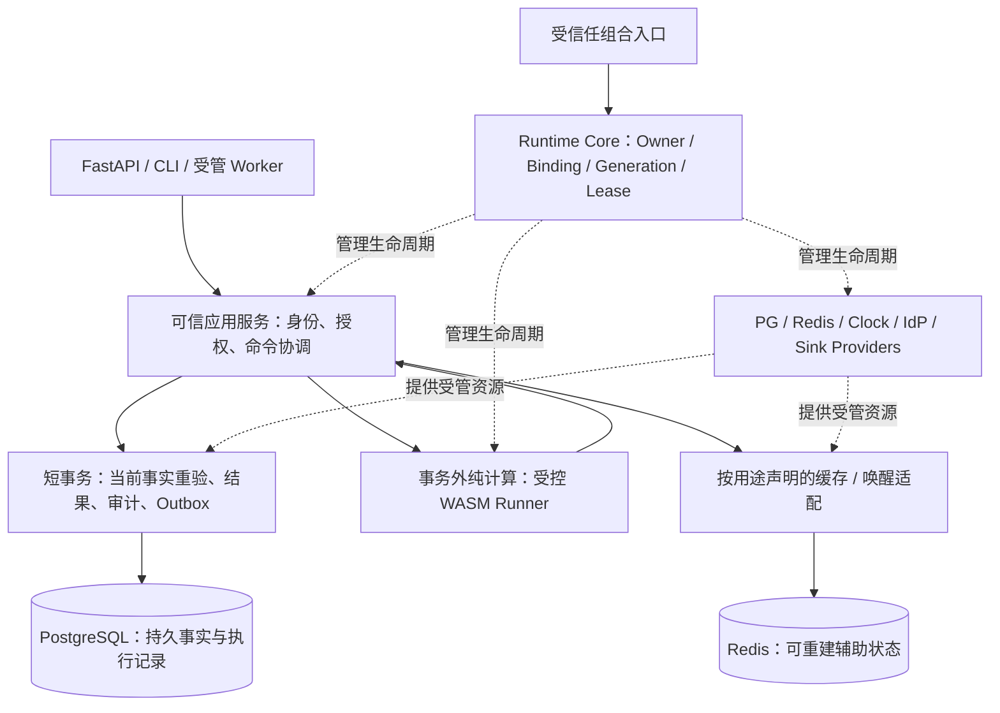

# Stage 一期基础框架实施规格

一期采用 **Python 原生组件 Core＋可信应用服务＋PostgreSQL/Redis provider＋受控 WASM runner**。Core 保留 Cordis 的 effect/coeffect、资源 owner、响应式依赖、committed view、按服务键隔离及事件组合语义；应用层定义身份、授权、事务、发布和持久结果。Graphon/Dify 只作参考。

本文件细化 [Core 一致性规格](runtime-conformance.md)的实施接口和并发边界，作为 P1a 的实施依据；整个一期范围仍由 [phase-1](phase-1.md)定义。2026-10-25 已实现 P1a.1～P1a.3，并完成 Python 46 场景映射、真实 PG/Redis 与云设备验收，见[P1a 记录](reviews/p1a-validation-2026-10-25.md)。归属、状态和失败语义不能静默改变。

## 1. 参考与分层

本轮通过固定 Maestro 提交 `6f7124baabca582d43ce84fd59d2f48e4b790763` 核对并执行 Cordis 参考。它包含 DSH 补丁，不能等同纯上游。35 组同描述操作的 TS/Python 结果一致，9 组预声明差异符合预期；具体覆盖见[参考证据](reviews/runtime-reference-2026-10-25/coverage.json)。论文沿用原核查依据，未重新读取 PDF。D-01～D-09 在[一致性规格](runtime-conformance.md)集中维护。

Core 不导入 FastAPI、ORM、角色名、授权投影或业务 ExecutionContext。应用服务通过 Core 的服务键和租约取得实现，再自行构造可信身份；取得服务不能授予业务权限。组件是逻辑模块，不要求每个组件单独进程或 Python 分发包。

| 层 | P1 职责 | 状态权威 |
|---|---|---|
| Runtime Core | 组件依赖、owner、代次、资源与调用租约、事件、任务监督、就绪/关闭报告 | 当前进程的运行状态 |
| Bootstrap / Providers | 受控装配，PG/Redis/身份客户端/runner/sink 的资源建立、探测与释放 | 组件拥有资源；外部服务保存各自事实 |
| Execution / IAM / Release | 真实认证、可信事实加载、授权、准入、稳定幂等、命令分段和提交 | PostgreSQL 中的权威业务与治理记录 |
| WASM Host / Runner | 受控输入、预算、隔离进程、结构化回执 | 计算尝试；输出经宿主重验才能提交 |
| Future Workflow | 固定定义、分支、等待和恢复 | 后续 P3 持久实例，不能存成 Fiber 的内存状态 |

## 2. 两张图与三类状态

**Owner 树**回答资源由谁创建、谁负责收尾：每个 child Fiber 只有一个结构父，每条 effect 属于一个 owner/generation。**服务依赖图**回答当前激活使用哪个 `(realm, key, provider_id, generation, registration_id)`：消费者可依赖兄弟、祖先或外部 provider，不能仅靠 owner 树倒序卸载。两图共同决定停止与释放顺序，不新增业务工作流图到 Core。

身份字段属于每次 `ExecutionContext`；数据库版本属于业务对象；Core 的 generation 与 change_revision 属于组件。tenant、业务 revision、制品 digest、组件 generation 和 Redis TTL 各自表达不同事实。

组件的持久句柄 `PluginHandle` 与激活代次分开。同一实例可以因依赖变化重新激活；结构 child 在父代次退出时被销毁，父下一代次重新创建 child。`DISPOSED` 为终态；不能把旧句柄复用为新实例。

## 3. 最小模块与接口

下列逻辑接口已由 P1a 实现；registry/tasks 协调合并在 host.py，公开用法见[Core README](../app/runtime/README.md)。P1a 使用显式组合代码；配置 Loader、源码 HMR、通用 DSL、插件上传和多 ASGI worker 后置。

| 文件 / 对象 | 必要表面与义务 |
|---|---|
| `runtime/contracts.py` | `ServiceKey[T]`、`BindingIdentity`、`PluginSpec`、状态与结构化报告；服务键固定 namespace/name/interface version |
| `runtime/effects.py` | `EffectScope`、`EffectHandle`；登记先于 setup，支持同步/异步/生成器适配，统一管理关闭操作 |
| `runtime/context.py` | `require/get/provide/isolate/intercept/plugin/effect`；上下文视图不可变，明确 owner/generation |
| `runtime/registry.py` | 内部 binding、键预留、依赖索引、committed/target view；外部只能取得只读诊断 |
| `runtime/leases.py` | `ServiceLease[T]` / `CallScope`；固定绑定与调用 owner，原子取得/释放，不含 actor/tenant |
| `runtime/host.py` | `load/retire/restart/replace/await_ready/snapshot/close`；操作由 host 跟踪，每实例转换串行 |
| `runtime/events.py` | 类型化 `EventKey`、显式 Continue/Stop、监听登记及在途 dispatch 归属 |
| `runtime/tasks.py` | owner 内后台任务的停止信号、取消、完成与故障通知；故障不越过既定组件监督边界 |
| `bootstrap/`、`providers/` | 固定组合与应用适配；复用现有 DB/Redis 工厂，部署迁移不放入组件启动/卸载 |
| `execution/` | 业务命令注册表、CapabilityBinding、事务协调；贡献使用 Core 的 owned registration，Core 不解释命令 payload |

文件可以在首次实现时合并，接口不能形成两套竞争的 owner 或状态机。`PluginSpec` 固定 plugin/version、required/provided 服务声明、配置校验和启动回调；提前声明 provided 集合用于冲突与等待环诊断。实例配置由组合入口验证，任意 Python callable 仅来自可信代码。

`load()` 验证并登记实例，返回 handle，缺依赖时保持 PENDING，不阻塞等待其未来 provider。`await_ready(required, deadline)` 与加载分开；required 集合及预算来自可信组合入口。`snapshot()` 不等待；`retire/close` 触发由 host 持有的关闭操作；`restart` 必须先安全结束旧代次；`replace` 默认结束旧实例后再加载新实例。没有隐式无限重试。

## 4. 服务解析、发布与代次

- `ctx.require(key)` 先解析自身已提供项，再解析当前 committed binding；允许沿该 key 的相同 realm 继承祖先自行提供或已声明依赖的绑定，遇隔离边界即停止。未知声明链不得回退实时 registry。祖先绑定通过 owner 树在 child 结束前保持存活。
- `ctx.get(key)` 保留 Cordis 公共观察语义：绕过 inject，只观察当前 ACTIVE provider。它不执行 availability predicate，也不获得调用租约；发现对象不保证可开始新工作。业务调用必须通过声明绑定与 `CallScope`，诊断使用只读 snapshot。
- `isolate(key, label)` 和 `intercept(key, config)` 只创建同 owner/generation 的上下文视图；`plugin(spec)` 才建立 child Fiber。realm 按服务键隔离，不能当作租户数据隔离。
- intercept 顺序为 base → 祖先 → 后代/inject 配置 → head；默认浅覆盖，有特定 merge 的服务自行定义并测试。共享服务不修改 `self.ctx`，caller owner 与 provider 自身依赖视图分别保存。
- 一个 `(realm, key)` 的登记槽只能有一个 owner，包括尚在 LOADING 的预留项；check=false 不释放槽。启动时服务先暂存，整个 provider 成功进入 ACTIVE 才对消费者发布。ACTIVE 后按声明逐项 provide 是单项操作，不承诺多项注册原子事务。
- 每次 provide/监听/命令贡献均取得不可复用的 registration_id；更新、撤销句柄和调用 pin 绑定该登记身份。同 owner/generation 手工注销后再次登记同 key，也必须生成新 ID，旧句柄不能更新或删除它。
- availability predicate 是纯本地、快速同步判断；异常记为不可用。网络 PING、schema 探测由受管 provider 任务执行，并显式发布可用性变化；不在 registry 锁内调用任意用户代码，也不因每次 get 触发网络探测。
- committed view 固定 binding 身份，不冻结对象内容。`ProviderHandle.update_value()` 只允许当前 owner/generation 更新自身绑定，不自动 notify 或重启消费者；再次 require 看到新 value，既有对象引用保留原值。它仅适合明确允许更新的值型服务；连接池、runner、handler 等资源实现必须走换代，不能借此提前关闭旧资源。
- change_revision 随目标/配置/关闭意图单调增加；generation 随启动尝试单调增加。所有 await 返回、发布和撤销句柄核对所属代次及变更序号，防止 A→B→A 与无依赖组件配置变化让旧启动重新生效。旧 disposer 只能撤销自己的登记。

**新旧 provider 的两条路径必须区分。** 同 Fiber restart，以及 `host.replace()` 的默认路径，均为旧代次清理成功后再启动新代次。组合层若独立挂载不同 Fiber 的 P2，则必须等待 P1 的公开 binding 已撤销、槽已释放；此时 P2 可先可用，但旧消费者仍使用 P1 的 pin，只有自身旧 cleanup 成功才可重绑。P2 的发布不证明 P1 已关闭，也不允许绕过失败 owner 的恢复步骤。C4-02 验证后一种独立实例情况，不承诺默认 replace 零停机。

单独关闭 provide 登记也必须撤销新可见性并等待受影响旧消费者收尾；该操作不销毁 provider 的其他资源。owner 最终关闭时仍对其全部旧 binding 建立 drain 屏障，不能通过手工 disposer 绕过它。

## 5. 关闭协议与失败结果

每次卸载遵循以下阶段；同一 owner 的 LIFO 仅用于满足前置条件的资源释放，不能替代依赖协调。

1. **Invalidate**：冻结旧代次目标，在任何 await 前原子关闭目标及受影响依赖闭包的新业务调用/新 listener snapshot 接入，再撤销公开 binding。CallScope 取得时在同一受控变更边界核验所需 binding/registration 与依赖可接入状态并增加 pin，不能仅检查消费者仍显示 ACTIVE。已存在的 committed view 与调用 pin 保留。
2. **Quiesce**：先向受影响消费者、结构 children 和后台任务发停止接入/停止生产信号，随后按声明的取消策略推进。stop 回调只停止生产与唤醒退出，不关闭仍在使用的连接池。不能把触发退出所需的动作藏到 drain 后的 disposer。
3. **Drain**：等待旧调用、已选 listener、child 与 consumer 旧代次收敛。consumer 的 cleanup 可以用旧 committed binding 创建短期 session 完成必要记账；这属于既有 owner 的收尾，不能借机接新业务或登记新长期资源。provider 要等这些 pin 释放后才进入资源销毁。
4. **Dispose**：按依赖前置条件释放资源；同 owner 独立资源默认反序。存在相互等待的资源必须在组合 effect 中明确 stop/join/close 次序，不能依赖注册顺序碰巧解锁。独立分支继续清理，失败项可能仍被使用的依赖保留 blocked，不能强关后宣布结束。
5. **Report**：逐项记录 completed、failed、blocked/not-started 与未结束的任务/租约。只有全部收敛才可标记 DISPOSED 或开始该 owner 的下一代次；失败保留 `FAILED(phase=setup/drain/cleanup)` 与原错误。

Core 的三种保活需要分别计数：组件代次的 dependency pins、短期业务/事件 invocation leases、尚在收尾的 owner 操作。它们是进程内资源保护，不替代 PostgreSQL 的持久业务租约或 fencing。请求释放 ServiceLease 应在其事务/回执记账和 session 关闭之后完成。

effect 记录在执行 setup 前已归 owner。卸载开始后拒绝新 effect；已开始 setup 产生的迟到 disposer 仍归原记录并必须回收。资源在取得后、登记前遇到取消的窗口由原子资源适配器负责清理；Core 不能回收未报告的任意 Python 副作用。

外部并发 `close()` 加入同一关闭操作，某个等待者取消只结束自己的等待，不取消共享关闭任务。生命周期回调或受管调用若等待自己、祖先、其持有租约的 provider，或当前 dispatch 所选任意 listener owner 关闭，会形成等待环：此时拒绝阻塞等待，返回可定位的 `LifecycleWaitCycle`；使用非等待的 `request_close()` 把意图交给 host，并退出当前回调。serial 的 A 等待关闭尚未调用的 B 也在此限制内，因为同一 dispatch 已持有 B 的 pin。检测覆盖 Core 记录的 owner/operation/CallScope 等待关系，未知的用户自建锁/等待不受这种保证覆盖。

关闭超时只生成未完成报告，不能证明任务已停止。host 保留操作所有权及失败诊断，继续拒绝旧代次新接入；后续可再次等待。已失败的 cleanup 不自动重复执行逆操作；需要显式恢复且适配器证明可重试，不能确认资源结束时由进程级重启处理。启动失败也不自动循环重启，清理成功后才可显式 restart。

## 6. 事件、任务与就绪

保留 emit、parallel、serial、bail、around waterfall 的分工。parallel 等待全部监听完成并聚合异常是固定 Cordis 已有语义；Python 的同步 emit 限制与 Continue/Stop 是 D-07。权限强制检查必须是可等待且传播失败的调用，不使用可忽略的观测事件。

公共事件的新 dispatch 只选择 ACTIVE 且接入未关闭的 owner；LOADING 时登记的业务 listener 随整代激活可见。Core 内部状态协调与只读生命周期通知单独实现，不通过业务 listener 执行授权或破坏生命周期屏障。

异步 dispatch 在入口原子选定 listener snapshot，并取得每个选中 owner/generation/registration 的调用 pin。已选但尚未运行的 serial listener 也被保护；短路、异常或取消释放未用 pin。卸载先禁止新的 snapshot 选择该 owner，再等待已有调用结束，之后关闭其资源。dispatch 不持 registry 锁执行 callback。调用方取消时取消并等待其受管 listener 任务收敛；不合作的任务保留 pin 并形成 drain 未完成。这是 Stage 的 D-08；固定 vendor `events.ts:165–175` 只按上下文过滤并拍回调快照，未实施上述 owner 激活门控和调用 drain。

每个组件有独立任务域；后台失败立即通过 host 的状态/故障通道呈现。不可等应用 close 才发现 outbox poll 早已退出。可选 sink/Redis 故障使相应入口降级或不可用；PG、身份或命令必需组件失败阻断依赖入口。`/health` 仍是 liveness，`/ready` 基于显式 required 集合，不能以“没有待执行任务”推断 ACTIVE。

ReadyReport 至少包含 outcome（ready/pending/failed/timeout/stopping）、缺少的服务键/实例、已解析 generation 和失败引用；ready 同时要求 required 实例及必要依赖 ACTIVE、可用且接入未关闭。即时 snapshot 可以返回 pending；await_ready 持续等待就绪、失败、停止或 deadline，超时/调用者取消只结束等待，不取消组件加载。必需服务环与“父 setup 等待依赖父 ACTIVE 的 child”应诊断并阻止假就绪；参考 Cordis 的 `fiber.await()` 可以返回 PENDING，严格 readiness/等待环诊断属于 D-09。

## 7. P1a 的实际装配

| Provider / 消费者 | 接入与退出要求 |
|---|---|
| PostgreSQL | 复用 `create_engine`；启动前做有界连接/schema 检查，发布 session/UoW factory。池大小、溢出、获取等待和探测预算显式配置；每命令独立 session，所有 pins 释放后 dispose engine。迁移单独执行 |
| Redis | 复用 `create_redis_client`；显式配置池上限、获取/命令预算和用途故障策略，禁止 URL 绕过限制。没有业务消费者时可不装配；接入后只有依赖入口受其可用性影响 |
| 命令注册 | 应用层 owner 登记带版本的 handler，能力摘要与当前 provider generation 分开。统一租约覆盖一次受控调用，结束后释放；不按请求创建一棵组件树 |
| Outbox worker | 注册受管任务、运行故障通知、stop 与 close；取消后的 unknown/回执记账通过旧 DB 依赖完成。drain 失败阻止 storage 退役；原审查 R1/R2 在装配前修复 |
| FastAPI / CLI | HTTP 路由静态定义，lifespan 管 RuntimeHost；CLI 复用组合与执行服务。启动失败清理已成功启动部分；不在组件启停时修改路由/OpenAPI |
| P1a 验收 consumer | 使用虚构数据和内部可信 fixture 验证事务、取消及关闭，不开放临时业务 HTTP。真实 IAM 在 P1b 验收 |

现有短命令 Kernel、幂等/审计/outbox 与 PostgreSQL 测试继续使用。真实 IAM 接入前，应把 TrustState → 全局 Principal → tenant guard → 领域对象的锁协调放在应用层；不得把新锁塞到已先获取 tenant guard 的旧 loader 后面。P1c/P1d 的 WASM 必须经过快照事务 → 无锁计算 → 重验提交三段；P1a 只冻结接缝，不提前构建通用流程引擎。

## 8. 分段交付与补充验收

| 阶段 | 交付 | 退出依据 |
|---|---|---|
| P1a.1 | 资源 owner、effect、注册/依赖、状态及代次、committed view | C1–C4＋相应 S1 场景；未实现能力保持显式未完成 |
| P1a.2 | quiesce/drain、调用租约、realm/intercept、caller owner、事件与任务监督 | C5–C8＋S1 并发边界，固定参考对照和 D-01～D-09 差异证据 |
| P1a.3 | PG/可选 Redis provider、DB consumer、worker、lifespan 与 readiness | 真实 PG、Redis 相应用途、取消/故障/关闭场景及既有回归 |

原 C1–C8 的 **34 个场景保留**，加以下 **12 个 S1 边界场景**已映射到实际成功测试。映射节点、执行结果与代码摘要见[机器证据](reviews/p1a-runtime-conformance-2026-10-25.json)，不替代身份/WASM验收。

| ID | 必须验证的行为 |
|---|---|
| S1-01 | PENDING/缺依赖/依赖环/父子启动等待环与 startup failure 可区分；readiness timeout/取消不伪造 ACTIVE 或取消共享加载 |
| S1-02 | LOADING 占用键、失败撤销、整代服务可见性、ACTIVE 单项注册、手工关闭 provide 都遵守同一登记和 drain 规则 |
| S1-03 | require 的自身 provide、同 realm 祖先自提供/声明依赖的继承、realm 边界与未声明拒绝；派生 context 不增加 Fiber |
| S1-04 | get 不执行 availability check/不授予租约；值更新后的新读取和旧引用符合约定，越 owner 更新拒绝、资源替换走换代 |
| S1-05 | sibling/parent-child 依赖退役时先通知全部 stop，再等待；停止信号不被 LIFO 或 provider 屏障阻塞 |
| S1-06 | provider 失效到异步通知 consumer 之间，依赖闭包的新调用也被原子拒绝；旧 consumer/worker 仍可完成取消记账，pool 关闭晚于全部旧 pin 释放 |
| S1-07 | 并发 close、取消一个 waiter、setup/cleanup/callback 自等待及等待同 dispatch 其他 owner 关闭均有明确结果；迟到资源被原 owner 回收 |
| S1-08 | serial 的后续 listener 在入口已获 pin，卸载不能先释放它的依赖；A 不能阻塞等待关闭 B；短路和异常释放未用 pin |
| S1-09 | parallel 取消与不合作 listener 的实际终止区分；未收敛任务保留 pin，独立分支可清理、依赖资源仍 blocked |
| S1-10 | A→B→A 与 LOADING 中自身配置更新不复活陈旧启动；同代次重新登记也生成新 registration_id，旧 update/disposer 不能影响新登记 |
| S1-11 | 同实例/默认 replace 严格串行；不同 provider 独立注册可见时旧 cleanup 仍读取旧绑定；cleanup 失败不触发旧消费者自动重绑 |
| S1-12 | PG/Redis provider 池耗尽与探测失败有界；可选组件故障隔离、必需组件 readiness、worker 失败通知、schema 不符和关闭未完成均可观察 |

S1 中与参考相同的部分做 shared-semantics 对照；涉及 Stage 保证的部分关联 D-ID，仅在 Stage 断言。C2-04 的重复 provider 与环诊断也分别报告，不能要求 TS 参考给出不存在的环诊断。

P1a 的 34 个 C 场景、12 个 S 场景及真实 provider 接入已通过本轮验收。P1b 真实身份、P1c 签名与 WASM、P1d EvaluateQualification 继续按原规格推进。具体身份 profile、引擎/ABI/签名参数在所属阶段冻结，不能从 P1a 完成推导已选定。

前序[源码与文档核查记录](reviews/framework-validation-2026-10-25.json)保留当时的设计检查证据；运行验收以新的[P1a 记录](reviews/p1a-validation-2026-10-25.md)为准。
