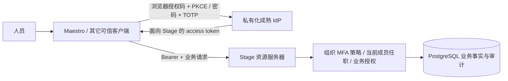

# Stage 与 OAuth/OIDC 身份提供方的职责讨论

> 2026-10-26 后续决定已更新：用户授权自研最小认证与 OAuth/OIDC 模块并详细复测，见[现行设计](native-authentication-design.md)。下文保留当时复用 Keycloak 的建议及权衡，不再作为禁止自研发行服务的现行要求；凭据认证与组织授权的职责分离继续适用。

本轮用户提出在完成人员任职发现、登录 MFA 的同时讨论 Stage 是否作为 OAuth 的身份提供方。建议当前继续让成熟 IdP 承担登录和 token 签发，Stage 负责组织身份映射、成员任职与当前业务授权。产品可以交付统一登录体验和私有化身份服务，但不需要把 Stage 后端自研成协议发行方。本建议不构成用户已决定建设或放弃长期身份产品，也不新增 `/authorize`、`/token`、Discovery、UserInfo 或 JWKS 签发接口。

## 1. 三类职责

OAuth 2.0 的角色包含授权服务器（Authorization Server）和资源服务器（Resource Server）；OIDC 在 OAuth 之上定义登录身份协议，其身份提供方称 OpenID Provider（OP）。同一个成熟产品可以同时承担 OAuth AS 与 OIDC OP。[S1][S2]

| 职责 | 当前承担者 | 负责的事实 |
|---|---|---|
| 登录、密码/TOTP、会话、恢复、授权码、refresh token、签名 key | 已选 Keycloak 开发 IdP，生产提供方另验收 | 发行者确实认证了哪个 subject、以什么强度、何时认证，token 面向哪些 audience/client |
| 登录交互与凭据保管 | Maestro 等可信客户端 | 系统浏览器、精确回调、PKCE、state/nonce、token 安全保管；客户端不自行宣布 MFA 成功 |
| 组织准入与业务权限 | Stage | 外部身份到 Principal 的精确映射、当前成员经历、任职/固定角色版本、scope/对象关系、撤权、事务与审计 |

Stage 验证 JWT 并返回 `/identity/me`，不因此成为 OAuth AS/OIDC OP。拥有人员、角色和成员表也不等于应当保存密码、TOTP 种子或自行签发登录 token。Stage 的内部 HumanAuthenticationEvidence 是短期事务重验证据，不是给其它系统使用的 OAuth token。

## 2. 推荐部署关系

企业已有 OIDC/SAML/目录系统时，可按具体提供方合同接入或由成熟 IdP broker 联邦。企业没有现成 IdP 时，可随 OrchestraCorp 私有化部署成熟身份组件；它与 Stage 保持独立的密钥、会话和协议责任。这样不会要求企业必须购买外部 SaaS，也不把模型或 Agent 变成登录身份发行者。

如果未来希望第三方系统使用 OrchestraCorp 统一登录，优先将第三方登记为该 IdP 的客户端，为各 API 分配准确 audience 和 scope；Stage 的动态业务权限仍由当前数据库判断。不要把企业所有角色塞进长期 token 并当作最终许可，亦不能让一个为 Stage 签发的 token 默认适用于所有第三方系统。

## 3. 当前不自研发行方的理由

自研 OAuth/OIDC 发行方还意味着维护客户端登记与精确 redirect 校验、grant/PKCE/nonce、授权码单次消费、登录和会话安全、token 签名与密钥轮换、refresh 重用/撤销、Discovery/JWKS/UserInfo、登出/恢复、浏览器兼容及协议安全更新。这些职责不会因为已有任职表或 MFA 准入检查自动完成。[S1][S2]

Stage 当前仍在建设人员客户端接缝、受控执行和业务能力。重复实现发行协议会扩大维护和验收范围；而统一登录、密码＋TOTP和跨客户端 SSO 可以由独立成熟 IdP 提供。Stage 可以在产品层提供配置/引导和组织管理，但应明确哪些动作实际委托给 IdP，不能把一个转发接口包装成已自研完整协议平台。

## 4. 与本轮 MFA 的配合

用户已选择首个因素组合为密码＋TOTP。IdP 实际执行两步并产生 ACR/AMR/auth_time；Stage 组织级策略要求精确 profile/version、规定强度与原始认证新鲜度，阻断切回旧弱 profile。refresh 更新 JWT 的 iat 不会使原登录重新变新；业务提交及历史结果读取仍重验当前政策。

有效 token 强度不足时，Stage 返回 `401 MFA_REQUIRED`，并用 Bearer `insufficient_user_authentication` challenge 表示需重新认证；该错误语义借鉴 OAuth step-up 规范。[S3] 客户端依据预先受信的登录配置发起 MFA，不从未验证 token 的 issuer 或任意错误 URL 建立新信任。

当前仍是离线 JWT 验证：IdP 注销/停用不会自动立刻使已签发 JWT 在 Stage 失效；本地成员/任职/政策撤销通过 PostgreSQL 立即参与后续判定。若生产需要更快同步外部注销，另选并验收 introspection 或可信事件/登出协议，不能声称因接入成熟 IdP 就天然具备即时跨系统撤销。

## 5. 何时重新评估

当存在明确的第三方身份发行需求，或成熟 IdP 无法通过受支持配置/扩展满足必须的信任语义时，再比较独立身份组件、受控 broker/adapter 与自研发行方。评估须明确协议消费者、长期维护责任、密钥与账户恢复、撤销承诺及兼容验收。身份产品能力可以扩展，Stage 业务授权与 IdP 协议权威仍应分别管理。

现阶段建议：**交付统一身份体验，复用成熟 IdP；Stage 专注组织事实与受控业务执行。** 本轮代码继续沿此边界完成任职发现和 MFA，没有偷偷增加新的 token 发行服务。

## 参考

- [S1] [RFC 6749 §1.1：OAuth 角色](https://www.rfc-editor.org/rfc/rfc6749.html#section-1.1)。
- [S2] [OpenID Connect Core 1.0](https://openid.net/specs/openid-connect-core-1_0.html)。
- [S3] [RFC 9470：OAuth 2.0 Step Up Authentication Challenge](https://www.rfc-editor.org/rfc/rfc9470.html)。

本轮只读获取上述官方文档，均返回 HTTP 200；引用用于职责和协议语义讨论，不构成协议兼容认证。
