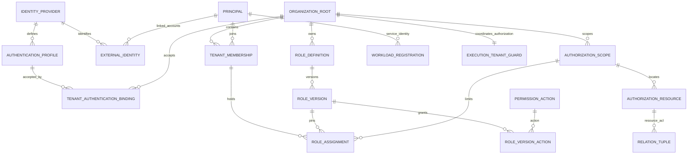

# Stage 身份、授权与 PostgreSQL 表结构对齐稿

**部署边界（2026-10-25 更新）**：当前产品为企业私有化部署，每套 Stage 使用一个组织授权根、专属数据库和一个环境。组织授权根是信任、治理、授权 epoch 和审计边界，不等同于一个法人公司；集团、子公司、部门等业务组织单元以后按需建模，scope 是授权范围，不自动等同组织树。`tenant`、`tenant_membership`、`tenant_ref` 等已落地名称暂不全部重命名，本文后续出现的 tenant 都指唯一部署组织根，不表示 SaaS 多租户。根表已通过 `d6a3c5f8e902` 无损重命名为 `organization_root`、根列为 `organization_ref`；子表兼容字段仍可使用 `tenant_ref`。根增加单例约束，身份入口由服务端解析它；没有根记录时拒绝成员访问，不能从请求参数选组织。迁移发现多根历史数据时明确拒绝，不自动合并或删除；单环境与历史混合环境检查另由离线 bootstrap/revoke 在管理锁内执行。部门、团队、项目继续使用 scope。公开响应使用 `organization_ref`，个人资料职责见[私有化部署与 API v1](private-deployment-api-v1.md)，完整根语义见[组织授权根语义](organization-root-semantics.md)。

一期采用“人员—公司—人员”：认证来源 → 已认证人员主体 → 组织根内当前成员 → 明确选定任职 → 对象与条件判定 → 共享业务命令与审计。Agent 是人员监督下的工具，不作为独立成员、任职或协作者，不另设 Agent 业务 API。RBAC、ReBAC、ABAC 组合在授权层；Core 管理资源生命周期，待实现的 WASM 宿主负责受限业务计算。人员凭据不交给模型、Agent 沙箱或 WASM，生成内容不能决定 actor、权限或人工确认；真实确认必须有对应证据。详见[人员—公司—人员协作边界](people-company-collaboration.md)。

本文区分一期现行目标与后置候选。P1b.1/.2 已有认证、组织成员和人类/WorkItem 授权；P1b.3 接通真实人员证据到元数据命令提交前重验，见[本轮记录](reviews/p1b3-human-work-2026-10-25.md)。P1b.4 已增加组织统一人员认证策略与本人任职查询，见[本轮记录](reviews/p1b4-assignments-mfa-2026-10-26.md)。ServiceGrant、AgentRegistration、AgentWorkloadBinding、Delegation 及 terms 不是一期表或 loader 前置条件，未来有真实需求时另行评审。既有枚举、历史数据和测试保留；专项边界继续由[身份规范](identity-and-authorization.md)、[P1b 入口](p1b-implementation-entry.md)和[WASM 规格](wasm-host-design.md)约束。

**当前物理 schema 与目标的区别**：迁移 `f4c7b2a1e903` 从 `d6a3c5f8e902` 新增 `permission_action`、`role_definition`、`role_version`、`role_version_action`、`authorization_scope`、`authorization_resource` 六张表；后续 `9c2e7a4b6d10` 新增 `organization_human_authentication_policy`，随后 `e8a1c6d9f240` 新增八张本地认证/会话/协议/安全事件表，安全审计迁移 `b7f0d3a9216c` 再增加首次因素绑定授权标志，多应用 OAuth 迁移 `c6f3a19d820b` 再增浏览器会话、同意与退出请求三张表，随后首管管理切片 `a7d4e2c9f501` 新增 management_authority，保存精确首管提名、永久接受标记与有限可授清单，当前应用表共 38 张（认证部分明细见[原生认证设计](native-authentication-design.md#6-已落地的实现边界)）。新授权表和旧任职/关系新增的根引用物理名均为 `organization_ref`；旧身份子表的物理 `tenant_ref` 继续兼容。下文保留的 tenant 字段表示逻辑组织根外键，不能作为要求新表继续使用 tenant 命名的依据。旧任职/关系保留未映射行，loader 只采用完整的新引用。`execution_audit.authorization_json` 保存有 schema 的当前授权事实版本摘要；它不包含 token，也不是可重用权限票据。

当前 loader 只装载一个明确 HUMAN 任职、固定角色版本、最多 64 层 scope 祖先和 WorkItem 的直接 `viewer_of/owner_of` ACL；分类上限固定 `internal`。WorkItem 的兼容 `scope_ref` 必须与资源登记一致，分类、状态和对象版本仍来自 WorkItem。该模型已接入公开 WorkItem 读取/元数据编辑和结果恢复，但不代表任务、承诺或验收领域已实现。角色版本内容不可变由可信注册器和加载摘要校验保证，当前没有数据库 immutability trigger；有数据库写权限的可信宿主仍属于信任边界。

## 1. 已对齐的规则

1. **稳定动作、版本化角色、具体任职分别保存。** `engineering-member` 等是初始角色模板；任职绑定组织根、成员、范围和准确角色版本。业务调用稳定 action，不比较角色显示名，不自动并集全部任职。
2. **登录关联不扩大组织根接受范围。** 同一个 Principal 可以关联多个受信任账号，但部署根必须接受本次认证的 issuer/profile/client/强度。有效 membership 不跳过认证来源准入。
3. **人员成员关系以一段加入经历为单位。** 离职/撤销是终态；重新加入创建新的 membership_ref，旧 assignment 仍引用旧经历。暂停可恢复，但属于明确恢复原授权的操作；重新授予权限不复用已撤销对象。
4. **关系有唯一事实权威。** member_of 由 membership 推导，未来 assignee_of 从任务承诺推导。不能同时允许用户独立修改源表和同义关系副本；delegated_by 仅是后置候选。
5. **自动化辅助不产生独立授权主体。** 当前人员任职、动作、资源与条件决定权限；工具自报身份或输出 approved 不授予权限，也不构成人工确认。将来若采用委托/服务授权候选，须逐条保存动作—目标，不能以两个数组交叉扩权。
6. **ABAC 读取可信属性，事务执行不变量。** 时间/认证强度/分类/金额来自明确权威；版本、状态迁移、额度和撤销在提交事务重验。多方批准有冻结意图和独立证据，不能用 `two_person=true` 代替。
7. **所有授权依赖均可定位版本和到期。** principal epoch、组织根 authz epoch、行 version、角色/策略版本及时间截止分别表达，不将一种版本当作全部当前性。

本轮同步既有合同的具体变化：

- 身份规范中的 TenantMembership“tenant/principal 二者唯一”细化为“未终结成员经历唯一”，历史经历允许多条。
- 当前 Delegation dataclass 保留历史结构；若以后采用独立委托，应评审逐条 action-target terms，不能把两个数组的笛卡尔积当作授权。该改造不是一期任务。
- 新数据库路径已从固定 RoleCode 映射演进为可信角色版本输入，角色名不隐式授予权限；旧可信 fixture 路径保留原映射。autonomous service 和 Agent 持久授权分支尚未实现，且已后置；服务认证已实现不代表这些分支已实现。
- 第 6 节的全局共享/独占锁已用于人员身份读取与 P1b.3 元数据命令；认证 profile/trust/映射/来源准入与当前单任职在同一命令事务重验。具体验收见本轮记录，不推广为全部 IAM 或后置 Agent/ServiceGrant 路径已经实现。

## 2. 核心对象关系

此图只展示当前一期主要关系，具体多列外键见下文；Agent/委托/通用 ServiceGrant 候选不列为现行依赖。WorkloadRegistration 是已实现的技术服务认证，不是业务协作者关系。



## 3. 类型、状态和公共约定

- 延续现有公开 `*_ref` 语义：新引用使用宿主生成的随机 UUID 字符串，主要列采用 `varchar(128) COLLATE "C"`，resource_ref/scope_ref 沿用 256，action_ref 沿用 96。旧 `principal.id/ref`、任职/关系的数字 ID 和执行 ID 不重编号。此阶段不把所有旧主键改为原生 UUID。
- 企业内安全表继续以 `(tenant_ref, object_ref)` 为主键或候选唯一键。外键保留部署组织引用；唯一根约束不替代主体、成员和 scope 条件。需要同时绑定主体的地方提供 `(tenant_ref, object_ref, principal_ref)` 唯一键。
- 新安全行使用 `version bigint NOT NULL CHECK(version > 0)`；epoch 使用非负 bigint。可变状态的更新用 expected_version 条件更新并推进相关 epoch。角色定义内容不可原位修改，版本撤销状态可以受控更新。
- 时间使用 `timestamptz`；有效期为 `[valid_from, expires_at)`，检查 `expires_at IS NULL OR valid_from < expires_at`。后置 Delegation/ServiceGrant 候选如采用，另须明确有限授权期限。
- 授权对象状态采用各自有限状态机，至少区分 active、suspended 与终态 revoked/expired；membership 另有 left。revoked 必须有 revoked_at 和变更来源。不能仅凭状态字符串推导当前有效，查询仍检查时间和关联对象。
- 同成员/角色/范围的未终结重复授予可用 `WHERE status IN ('active','suspended')` 部分唯一索引拦截；自然到期不会自动移出该索引，显式结束旧记录后才能重授。索引不包含 `now()`。需要重叠预约任职时另行定义区间排斥规则，P1b 不默认支持。
- 授权关键引用、状态与版本用明确列和外键；JSONB 只保存有固定 schema 的 profile 参数、受限证据摘要或原因，不保存可由客户端任意编辑的“所有权限”。所有安全表历史引用使用 RESTRICT/NO ACTION，禁止级联删除审计链。
- 通用 `created_at/updated_at` 只说明记录时间；`version` 表示当前内容变化，`revoked_at` 表示明确撤销。它们不相互替代。

## 4. 表结构建议

下面按责任列出一期目标及后置候选。A/B/C/E 仍须区分目标字段与已实现迁移；D 明确不属一期建表任务。按第 10 节分段迁移，不能用“建好了全部空表”作为认证或授权验收。

### A. 认证来源与主体

| 表 | 主要字段 | 约束、权威与说明 |
|---|---|---|
| `principal`（扩展） | 保留 id/principal_ref/principal_type；加 version、identity_epoch、recovery_epoch、disabled_at、status | principal_ref 永不回收；加 UNIQUE(principal_ref, principal_type) 供类型外键；不保存公司角色/密码 |
| `trust_state` | trust_ref、purpose、trust_config_revision、key_status_revision、configuration_digest、version | purpose 分开 authentication/release；平台受控配置的当前锁点/版本。不是任意请求可登记的信任根 |
| `identity_provider` | provider_ref、issuer_exact、trust_ref、status、version | issuer_exact 精确唯一；provider 的 issuer 不原位换成另一发行者。URL/endpoint 来源受控，issuer 不能由 token 自报后动态注册 |
| `authentication_profile` | profile_ref、profile_version、provider_ref、subject_namespace、credential_kind、stage_audience、config_schema、config_json、digest、status/version | UNIQUE(profile_ref, profile_version)；config 包含算法、预配置 endpoint、client/claim/assurance 解释、验证时效，内容版本不可变。human/workload 采用互斥语义 |
| `tenant_authentication_binding` | tenant_ref、binding_ref、profile_ref/version、environment、client/assurance 约束、status、validity、version | FK tenant/profile；部署企业只接受明确登记的认证组合。subject namespace 和调用环境由可信 adapter 推导 |
| `organization_human_authentication_policy`（P1b.4 已实现） | organization_ref PK/FK、version、mode、rules_json、max_auth_age_seconds、created_at/updated_at | 一组织一策略；required 时规则精确绑定 human profile/version，固定 ACR/AMR 和 1–86400 秒认证年龄。配置、epoch、journal 同事务；旧弱 profile 不能绕过。迁移已有根 disabled/v1，不默认开启 MFA；缺行兼容 disabled/v0，读取失败或坏内容不能降级 |
| `external_identity` | external_identity_ref、provider_ref、subject_namespace、subject_exact、principal_ref、principal_type、link_evidence_ref、status、version | UNIQUE(provider_ref, subject_namespace, subject_exact)；主体类型外键指向 principal。禁止按 email 合并，账号关联须有受控证据；不允许同外部身份分配给第二主体 |
| `workload_registration` | workload_ref、service_principal_ref、principal_type='service'、profile_ref/version、external_identity_ref、verified_client_ref、environment、status、validity、version | 主体类型与映射主体须同时匹配；加 UNIQUE(workload_ref, service_principal_ref, environment) 供下游引用。profile 验证过的 client/grant/环境决定服务来源，不仅比较 sub。凭据只保存托管引用，不保存 secret |

provider 表是精确 issuer 的稳定身份；profile 变更不能产生一个新 issuer 命名空间以绕过已有账号映射。subject_namespace 是固定 profile 定义的语义类别，如 human/sub 或 service/client，而不是请求参数。外部 issuer、subject 按协议原样精确比较，字段字节上限在 profile 中固定，以便唯一索引可控。

同一 provider/subject_namespace 在不同 profile 版本中必须保持主体类型、subject 来源和映射语义不变，不能把原 human/sub 重新解释为 service/client。可信 profile 注册器检查此约束；确需改变语义时登记新的 namespace，并重新完成明确账号关联与租户来源准入，不能自动继承原映射。

远端 JWKS 的轮换与本地禁用/信任变更分别处理。缓存中的公钥不是自行建立的新信任根；P1b 若未实现可审计的单 key 禁用表，则通过停用相关 profile/provider 保守拒绝，并明确撤销窗口，不能只增加一个 key_status_revision 就宣称单 key 撤销已实现。

### B. 组织根内成员、范围与资源

| 表 | 主要字段 | 约束、权威与说明 |
|---|---|---|
| `organization_root`（旧 `tenant` 兼容名） | organization_ref、deployment_slot（SmallInteger，默认 1）、display_name、status、version | 一套数据库的唯一组织授权根；deployment_slot 固定值的 CHECK＋UNIQUE 限制最多一行。根不是法人登记表，名称不作安全标识；停用也通过受控变更协议 |
| `tenant_membership` | tenant_ref、membership_ref、principal_ref、principal_type、status、valid_from、expires_at、ended_at、version、source_ref | 代表一次成员资格经历；加 UNIQUE(tenant, membership, principal)，主体类型外键；同 tenant/principal 最多一条 active/suspended。left/revoked/expired 后重入用新 ref |
| `authorization_scope` | tenant_ref、scope_ref、kind、parent_scope_ref、status、version | 组织根内的授权范围，可形成有限范围关系但不必等于组织树；父外键必须同根；P1b 采用有界深度查询。环检查及移动在 root guard 下由事务验证 |
| `authorization_resource` | tenant_ref、resource_ref、resource_kind、scope_ref、version、status | 资源授权引用登记，FK 同租户 scope；给 ACL/grant 提供真实 FK。它不保存业务金额、工作流状态或对象业务 version |
| `execution_tenant_guard`（扩展） | tenant_ref、epoch bigint | 复用已有表，加 FK tenant，不另建第二套授权 guard。受影响授权集合变化与 epoch 推进同事务 |

`authorization_resource` 是资源身份与安全范围的权威索引；领域表通过 `(tenant_ref, resource_ref)` 关联它，领域命令在一个事务内创建/改变两者。金额、分类、交付版本等仍由各领域持有并由 loader 读取；不得再保留一个可独立修改的同义 scope。旧 work_item.scope_ref 在过渡期只作迁移来源，切换后由登记表统一解释安全范围。

本组表只表达授权根、成员经历、授权范围和资源登记。集团、子公司、事业部等组织单元，以及需要时的法人/结算主体，不在 `tenant` 兼容表中伪造；它们应在未来领域表中以明确的 `organization_unit` / `legal_entity` 建模，再由授权策略决定哪些 scope 或任职引用它们。组织单元父子关系不自动产生权限继承。

允许 company、department、project 等有限 scope kind，但 scope 是授权边界，不代替完整部门/项目业务表。新增 scope 不自动授予权限；scope descendants 是否包含将来新建资源必须在授权 term 中明确。

### C. RBAC 与 ReBAC

| 表 | 主要字段 | 约束、权威与说明 |
|---|---|---|
| `permission_action` | action_ref、resource_kind、contract_version、status | 由受信任应用能力目录登记，如 task.delivery.submit。新增一行不会产生 handler 或授予任何主体权限；不兼容动作使用新标识 |
| `role_definition` | tenant_ref、role_ref、role_code、display_name、template_source_ref、status、version | UNIQUE(tenant, role_code)；工程角色是初始模板，公司内采用后独立版本化，显示名可变 |
| `role_version` | tenant_ref、role_ref、role_revision、content_digest、policy_release_ref、status、version、revoked_at | PK(tenant, role, revision)；发布后的能力内容不可变，撤销记录可变；无隐式 latest。旧版本是否仍可用由其状态与平台硬约束共同决定 |
| `role_version_action` | tenant_ref、role_ref、role_revision、action_ref | PK 全部字段；复合 FK role_version，FK permission_action。角色状态/版本在 loader 中核验 |
| `role_assignment`（扩展） | 保留 id；加 tenant_ref、assignment_ref、membership_ref、principal_ref、principal_type='human'、role_ref/revision、scope_ref、status、validity、revoked_at、version、grant_source_ref | 人类任职；FK(tenant,membership,principal)及主体类型、role_version、scope。每行一个范围；一次调用选定一个 assignment，不自动跨任职并权 |
| `relation_tuple`（扩展） | 保留 id；加 tenant_ref、relation_ref、membership_ref、subject_ref、relation_type、resource_ref、status、validity、revoked_at、version、source_kind/ref/version | 仅承载其自身负责的资源 ACL。FK 同租户 membership/subject/resource；一项资源关系的来源明确。代码限制哪些 relation_type 可直接授予 |

角色版本被撤销后，引用该版本的所有 assignment 在下一次受控动作中立即按本地提交顺序失效。发布 v2 不自动改变 v1 任职；迁移任职须显式授予/变更并审计。平台强制规则（部署组织归属、scope 边界、主体类型、禁止自审、当前撤销等）始终由可信策略解释，不被企业角色版本覆盖。

`ROLE_PERMISSIONS` 保留给旧可信 fixture 路径；新数据库 loader 从固定角色版本装载明确 action，校验完整能力集合、内容摘要、动作目录状态和 `stage-authz:builtin-v1`。不能靠新角色名称获得旧 enum 对应权限，也不能把未来新增 action 偷渡进旧版本。平台 `ACTION_POLICIES` 继续由可信代码管理。当前离线注册器支持显式发布 `task.view/task.assign/task.metadata.update`；旧角色版本不会自动获得新增动作。其他领域 action 虽有固定策略，仍需要真实领域事实，通用 tuple 不能伪造 `assignee_of/reviewer_of` 等投影。

关系按下表分配权威，避免重复维护：

| 关系 | 权威来源 | tuple 的角色 |
|---|---|---|
| member_of | tenant_membership | loader 投影，不另建可写副本 |
| delegated_by（后置候选） | 如未来采用的 delegation | 不纳入一期 loader；不能靠一条关系授予代理权 |
| assignee_of / reviewer_of | 对应任务/承诺/验收分派领域事实 | P2 领域投影；如落表缓存须同事务更新并校验 source_version |
| owner_of | 取决于 resource_kind 的已登记领域归属 | 不能全局解释为所有权限，不能独立写两个真源 |
| viewer_of / contributor_of 等直接 ACL | 被明确指定为权威的 relation_tuple | 必须经受权命令修改，来源和有效期受检查 |

P1b 不建立无边界关系图推理；按已登记 relation type 和有界 scope 查询生成授权输入。ABAC 不新增万能 EAV 属性表；必要字段来自主体、任职、scope/resource 和领域表，规则来自固定/版本化的受信任 ActionPolicy。

### D. Service 与 Agent 的有限权限（后置候选，非一期实施约束）

以下保存此前候选字段以便追溯，**不建设这些表、不扩展一期 loader，也不安排固定后续阶段**。人员使用 Agent 工具不产生 Agent 成员或 Delegation。ServiceGrant 仅在真实后台技术任务需要独立权限时评审；已实现 workload 认证与 outbox Worker 不受本次范围收缩影响。

| 表 | 主要字段 | 约束、权威与说明 |
|---|---|---|
| `agent_registration` | tenant_ref、registration_ref、agent_ref、principal_type='agent'、membership_ref、responsible_membership_ref、status、version | UNIQUE(tenant, registration, agent)；agent_ref 引用 agent 类型 principal，FK(tenant,membership,agent)。成员与责任方必须在同租户且引用固定；新加入经历/责任方变更创建新 registration，不能让旧委托改绑 |
| `agent_workload_binding` | tenant_ref、binding_ref、agent_registration_ref、agent_ref、workload_ref、service_principal_ref、workload_membership_ref、environment、status、validity、version | FK(tenant,registration,agent)、(tenant,workload_membership,service_principal)、(workload,service_principal,environment)。同 registration/workload/env 的未终结绑定唯一；固定两端成员经历 |
| `service_grant` | tenant_ref、grant_ref、membership_ref、service_principal_ref、workload_ref、purpose、environment、status、validity、revoked_at、version、grant_source_ref | FK(tenant,membership,service_principal)、(workload,service_principal,environment)；purpose 区分 autonomous / agent_host，不允许承载 Agent 的授权默认变成独立业务授权 |
| `service_grant_term` | tenant_ref、grant_ref、term_ref、action_ref、target_kind、resource_ref 或 scope_ref、include_descendants | 逐条动作—目标；同租户 FK，目标恰好一个；autonomous 是服务自己的权限，agent_host 是代理执行上限 |
| `delegation` | tenant_ref、delegation_ref、agent_registration_ref、agent_ref、delegator_ref、assignment_ref、budget_policy_ref/version、status、valid_from、expires_at、revoked_at、version、can_redelegate=false | FK(tenant,assignment,delegator)固定人类任职；FK(tenant,registration,agent)固定 Agent 登记经历；必须有限期；候选最小方案不可转委托；重新授予新 ref |
| `delegation_term` | tenant_ref、delegation_ref、term_ref、action_ref、target_kind、resource_ref 或 scope_ref、include_descendants | 逐条动作—目标，创建时不超出委托人权限；调用时仍重验其当前权限，范围类型不能自行扩大 |

若未来采用本组候选，优先评审 exact resource term。scope term 只有明确注册匹配策略后开放，须说明是否包含后续新增资源；scope移动与成员变化也受授权 epoch 保护。两个不同 term 的 action 和 target 不交叉组合。

候选 budget_policy_ref/version 引用宿主已登记的不可变执行预算配置，由可信 loader 验证；未知配置拒绝，省略不得解释为无限预算。不因此建立通用额度账本，累计金额/用量限制在对应领域事务实施。

后置候选中的独立 Agent 动作若启用，要求同时满足：workload 认证及租户来源准入 → 当前 workload 成员经历、agent_registration、Agent 成员经历与责任方成员经历 → 当前 agent_workload_binding → agent_host ServiceGrant 限制 → 当前 Delegation → 委托人当前 membership/assignment/role/资源关系 → ABAC 与领域规则。自主服务走 autonomous ServiceGrant，不冒充人类。registration、binding、grant、assignment 与 delegation 中的授权来源引用不可原位改绑；新成员经历必须重新建立相应授权，旧引用不能自动跟随主体恢复。

### E. 受控变更与证据

沿用 `command_execution`、`execution_audit`、outbox 作为组织根内人员命令的结果/审计链，补齐已认证人员、membership/role-version 引用，以及有固定 schema 的最小认证和授权版本快照。已有技术执行来源字段保留；不为后置候选追加 grant/delegation 列。历史记录不据新规则重新解释或改写；原 token、密码和签名私钥不写入这些表。

`AuthenticationEvidence` 首先是每次请求的内存对象。需持久审计时，将其受限必要字段与业务结果同事务保存；evidence_ref 在没有持久证据行时只标识关联，不能假称可用外键。P1b 不为每次探针、登录查询建立海量证据表；P1c 的批准断言另建受限证据存储。

最小认证快照包含组织人员认证策略 version/digest、准确的 profile_ref/version、external_identity_ref/version 或 workload_registration_ref/version、trust 配置/密钥状态 revision、principal epoch、tenant authentication binding/version，以及 credential_expires_at/evidence_valid_until。只有已验证的 assurance 才能进入证据。提交 loader 不只检查 principal，还要重验映射/registration 与租户准入的当前状态和版本；相关 writer 使用相同 trust/principal 锁协议，防止检查与撤销交错。

平台主体/信任变更不能借用某个公司 tenant。当前已有小型 `identity_control_operation`（operation_ref、operation_type、idempotency_key、input_digest、actor_kind/ref、认证摘要、目标引用、before/after版本摘要、result、created/completed_at），作为平台受控操作的幂等结果与审计记录，不平行复制租户审计。UNIQUE(actor_kind, actor_ref, operation_type, idempotency_key) 限定重放；同键不同 input_digest 返回冲突。身份变更与结果记录同一 PG 事务提交；结果未知时用原操作标识查询，重新验证查询者当前权限。未来平台通知若需要 outbox，应有明确平台合同，不借用租户 outbox 的假 tenant。

首次初始化采用 `bootstrap_record(environment, bootstrap_type, bootstrap_ref, configuration_digest, initial_identity_ref, initial_grant_refs, completed_at)`，UNIQUE(environment, bootstrap_type)，初始化结果与初始授权同事务落地，完成后关闭入口。bootstrap_operator 是可审计的安装操作身份，与正常已认证人类的 actor_kind 分开，不虚构“首个登录管理员”。

每个 Stage 数据库只承载一个部署组织根和一个环境。开发工具在管理事务锁内核验 identity-foundation 初始化记录：环境不匹配或存在多环境历史时拒绝 bootstrap/revoke/install，包括重放请求。独立部署各自保存主体，不建立跨实例共享 Principal。既有结果可由原操作者按原环境和操作键只读恢复，不能用修改环境参数重新解释目标归属。

跨账号自然人关联、完整组织岗位管理、多方批准记录仍未一次建全。P1b.4先验证外部IdP的密码＋TOTP；后续用户明确选择自研最小认证，当前native_account等原生表已承载密码摘要、加密TOTP、恢复和会话，见[现行原生设计](native-authentication-design.md)。Stage组织策略继续统一检查强度、新鲜度及提交前版本；Passkey尚未实施。服务端因素绑定／恢复已验证，Maestro桌面、生产开户／恢复和管理登录仍需独立交付，见[企业完备性评估](reviews/enterprise-identity-completeness-2026-10-26.md)。岗位来源保留明确版本引用；HumanIdentityLink与批准事实在独立性场景实际实施时另建，不能凭email或两条principal证明两个自然人。

## 5. 关键外键和索引示例

以下是逻辑约束片段，不是可直接执行的迁移文件；既有表的数字主键保留，再添加候选唯一键供引用。涉及 Agent/Delegation/ServiceGrant 的片段和索引仅服务第 D 节后置候选，不是一期迁移要求。

```sql
-- 任职不能引用另一公司的成员，也不能换掉该成员代表的主体。
UNIQUE (tenant_ref, membership_ref, principal_ref)
FOREIGN KEY (tenant_ref, membership_ref, principal_ref)
  REFERENCES tenant_membership (tenant_ref, membership_ref, principal_ref)

-- 后置候选：委托人必须就是该任职的主体。
UNIQUE (tenant_ref, assignment_ref, principal_ref)
FOREIGN KEY (tenant_ref, assignment_ref, delegator_ref)
  REFERENCES role_assignment (tenant_ref, assignment_ref, principal_ref)

-- 子类型约束：数据库拒绝把 human 当作 service 注册。
CHECK (principal_type = 'service')
FOREIGN KEY (service_principal_ref, principal_type)
  REFERENCES principal (principal_ref, principal_type)

-- 后置绑定候选：同一 workload、实际服务主体和环境必须匹配；成员经历也要绑定该服务主体。
FOREIGN KEY (workload_ref, service_principal_ref, environment)
  REFERENCES workload_registration (workload_ref, service_principal_ref, environment)
FOREIGN KEY (tenant_ref, workload_membership_ref, service_principal_ref)
  REFERENCES tenant_membership (tenant_ref, membership_ref, principal_ref)

-- 后置候选：委托固定一次 Agent 登记经历；重新加入后不能自动恢复旧委托。
FOREIGN KEY (tenant_ref, agent_registration_ref, agent_ref)
  REFERENCES agent_registration (tenant_ref, registration_ref, agent_ref)

-- 后置候选：grant term 的目标只能选择一个；两个可空目标不允许产生重复项。
CHECK ((target_kind = 'resource' AND resource_ref IS NOT NULL AND scope_ref IS NULL
        AND include_descendants = false)
    OR (target_kind = 'scope' AND scope_ref IS NOT NULL AND resource_ref IS NULL))
UNIQUE NULLS NOT DISTINCT (tenant_ref, grant_ref, action_ref, resource_ref, scope_ref, include_descendants)
```

还需把 scope/resource、role_version、profile 引用纳入同租户或受信任平台 FK；上述例子只展示容易遗漏的“租户＋对象＋责任主体”一致性。数据库 CHECK 不能读取其他表的 active/expiry，也不能验证 grant 不超出授予人的当前权限，这些由事务服务执行。

索引按实际路径建立，避免每列机械建索引：

- membership：`(tenant_ref, principal_ref, status)`；另有全局平台撤销使用的 `(principal_ref, tenant_ref)`。
- assignment：`(tenant_ref, membership_ref, status)`、`(tenant_ref, role_ref, role_revision, status)`。
- tuple：`(tenant_ref, resource_ref, relation_type, subject_ref)`，以及按主体查可见资源的反向索引。
- 后置 delegation 候选：`(tenant_ref, agent_ref, status)`、`(tenant_ref, assignment_ref, status)`；terms 索引以 delegation/grant 加 action 起头。
- workload 已有认证路径；后置绑定候选另评估：`(service_principal_ref, environment, status)`、`(tenant_ref, workload_ref, status)`。
- profile/外部身份：精确 issuer/profile 外键及 `(provider_ref, subject_namespace, subject_exact)` 唯一索引。

## 6. 当前性、撤销与并发

沿用锁序：TrustState → 涉及的全局 Principal → tenant guard → 后续批准/激活 → scope/resource及领域对象 → command/result。同类 ID 稳定排序。先在锁外确定候选引用，锁后重读；依赖集合改变时整笔有界重试，不能拿到 tenant 锁后再补前面的全局锁。

**统一人员认证与命令锁协议**：身份读取和公开人员命令均先取得相关 TrustState/Principal 共享锁，再取得组织 guard；身份/信任撤销在对应全局行取得独占锁。命令的认证 loader 包装数据库单任职 loader，校验当前事务私有锁标记，加载固定成员经历、认证 profile/trust/映射/来源绑定及当前权限，并在提交前重验。原 `DatabaseAuthorizationLoader` 单独装配仍仅是可信内部路径，不能替代认证适配器。新增路径须验证全部相关 writer、依赖发现与锁后重验；PG 竞争及公开路径证据见[P1b.3 记录](reviews/p1b3-human-work-2026-10-25.md)。

所有依赖身份/信任的 writer 都必须遵守协议。新增/撤销 membership、assignment、ACL、组织根认证准入、scope归属或角色版本状态时，同事务推进 tenant guard.epoch；未来若启用 Agent/grant/term 候选，须另行纳入完整依赖与 writer 协议，不能复用人员路径的验收结论。底层 lock_tenant 只加锁、不递增 epoch；当前受控身份/授权注册与撤销路径已在同一事务推进相应 epoch，新增 writer 必须继续遵守这一协议。全局 principal/trust 变更分别推进其 epoch/revision，不伪称已向所有外部 IdP 同步。

tenant 自身停用同样持有 tenant guard 并推进 epoch；每条企业受控请求在锁后验证 tenant.status，不能仅验证成员 active。本期依赖集合覆盖人员当前成员与任职、实际认证映射及信任状态，相关身份锁按统一顺序取得。

已撤销 assignment 不恢复为 active；重新授予新引用。membership 重入也新建经历，旧授权继续被旧 membership 失效阻断。自然到期不自动更新 epoch，缓存和 WASM 快照必须保存最早失效时间并使用宿主时间重验。

identity_epoch 能使旧证据/缓存失效，但不能单独废止所有尚有效的外部 JWT。主体恢复启用时，如要求重新登录，需要该 profile 支持的会话撤销或明确时间栅栏；`iat` 不等于 `auth_time`，未知认证新鲜度不能当作已满足强认证。

IAM 写命令使用专门的受控协调路径：按变更前事实验证操作者→验证目标范围/expected_version→修改授权事实→推进 epoch→同事务结果/审计/outbox。现有普通 Kernel 的“handler 不修改判定所用安全事实”约束仍有效；不能直接把任职撤销塞入旧 handler，再用已撤销的自身权限去验证同一变更。Token 到期、命令 deadline 等时间约束仍须提交前检查。

当前并发实现已将组织保护分成准入门＋行锁S/X，普通业务使用S；来源／人员保护与授权写者X继续保证撤销排序。短命令另有入口幂等键同步，详见[实现记录](reviews/concurrency-optimization-2026-10-26.md)。这不改变上述表与epoch的权威边界，也不以缓存取代最终身份验证。

## 7. 与 WASM 的配合

P1b 先固定已认证人员的 `principal/organization/membership/assignment` 引用、authentication/profile/trust revision、当前 authz_epoch、动作/资源、对象版本与有效截止。计算模块、平台权限、Core 服务租约分别有不同含义。

P1c/P1d 再增加 `release_artifact/manifest`、`approval_intent/evidence`、`activation`、`qualification_fact_set`、`fact_snapshot`、`execution_attempt/computation_receipt` 和 `qualification_evaluation`。批准绑定不可变摘要、tenant/environment、动作与版本，双人规则基于可核验的独立主体证据；不是 ABAC 中一列布尔值。P1 当前最小制品批准仍是一名有权人。

资格计算路径：

```text
真实人员认证与组织根来源准入
→ 当前 membership 与选定任职授权，核验最小输入读取权
→ 短事务一致读取行 version＋FactSet revision＋最早失效时间
→ 释放锁，运行已准入的固定 WASM 与预算
→ 校验输出 schema、调用关联和模块/输入摘要
→ 新事务重验身份、当前授权、模块状态、事实集合和时间
→ 结果、审计、outbox 原子提交
```

FactSet 的集合 revision 覆盖增删改和空集合，tenant authz_epoch 只能反映权限集合，不能替代业务资格集合 revision。WASM 不获得 token、DB 连接或全量身份图；输出只作已批准业务规则的候选结果，不能授予角色、修改信任根或跳过当前授权。

## 8. 从现有表迁移

1. 保留既有 Alembic 历史，先只读盘点 principal/assignment/tuple/work_item 的状态、引用、孤儿和租户归属；输出受控映射清单。
2. 增量创建 tenant、认证、membership、scope/resource 和角色版本表；旧表先增加可空新字段，不假造默认公司或默认成员资格。
3. 依据有证明的映射回填 tenant、membership、稳定 ref、角色版本和 resource；不能从 scope_ref 的字符串前缀猜公司。新增成员/授权需要单独的采用或批准依据。
4. 无法映射的旧行保留并隔离出新 loader 的授权范围；不删除、不默认放行。新写路径只接受完整引用。存在未映射旧行时，停留在扩展阶段，阻止全表 NOT NULL 收紧和历史权限全量切换；内部新 loader 可显式装配，但只读取具有完整复合引用的新记录。独立历史归档方案另行评审，不能自动移走旧数据。
5. 全部目标行完成有依据的映射，并验证组合 FK、类型、唯一键后，才在受控切换窗口收紧 NOT NULL、替换旧唯一键并完成全量切换。P1b.3 公开路径只读取完整新引用，并通过认证包装 loader 与当前权限联合校验；它不进行历史权限全量切换。已有数据不靠破坏性 downgrade 回滚。
6. 执行/审计/outbox 的旧引用和结果保持原样；只对新命令写入新增认证与版本证据。全局身份写使用专用平台操作记录，不使用假造的 system tenant。

## 9. 验收重点

必须在真实 PG17 验证第二组织根被拒绝、部门/项目 scope 或成员错配被拒绝、wrong principal type 被拒绝、人员动作与资源范围无扩权、成员重入不复活旧授权、同主体多任职不自动并权、低保障 issuer 无法借账号关联进入受限组织根、全局禁用与多主体/多任职并发提交、自然到期、Redis失效消息丢失、结果丢失重放以及迁移保留旧数据。

数据库负责引用完整性、唯一性、结构约束和事务原子性；应用负责身份验证、当前权限、来源、锁集合完整性、epoch 推进、职责分离及领域不变量。认证与业务授权失败按安全的 401/403/不可用错误合同处理，普通响应不公开无权读取的其他主体与成员信息。

## 10. 分段实施与尚待冻结的部署参数

- **P1b.1**：Principal 扩展、tenant/membership、trust/provider/profile/租户准入、external identity、受控 bootstrap；真实 IdP 到最小身份读取链。
- **P1b.2**：scope/resource、动作/角色版本/任职、直接 ACL、可信 loader 与受控 dev/test 授权变更；已改造命令锁序和审计字段。正式企业 IAM 管理 API/UI 仍未交付。
- **P1b.3（人员命令切片）**：真实人员认证证据接到已有 WorkItem 元数据命令提交前重验；明确单任职、scope/资源、到期与撤销、原 key 恢复及认证/授权审计。无新表或迁移，具体证据见[P1b.3 记录](reviews/p1b3-human-work-2026-10-25.md)。此前此编号下的 Agent 绑定、ServiceGrant、Delegation 与 terms 后置，不是本阶段依赖。
- **P1b.4**：本人任职发现与组织统一登录 MFA 策略已实现，新增一张策略表；密码＋TOTP 的真实隔离协议与 Stage/PG 并发分别留证。本轮原生模块另外实现服务端因素绑定/恢复；Maestro 桌面选择和登录交互、生产接入尚待验收；正式人员与权限管理另收敛最小切片，不把开发 CLI 当管理产品。

“人员—公司—人员”“新 membership 表示新加入经历”“角色版本固定”“组织根认证来源准入”已确认为一期实施方向；动作—目标 term 配对仅作为后置候选的约束保留；全局 FOR SHARE/UPDATE 协调已用于现行人员路径，后续新增路径仍须分别验收。首条切片固定其实际支持的 token profile 和 public schema，其他 IdP/profile、Maestro Desktop/Web 登录拓扑继续按独立合同验收。领域实体与完整发布/WASM 表本轮只定义接缝，分别按后续阶段迁移。
