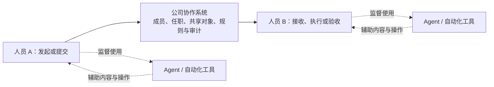

# 一期人员—公司—人员协作边界

2026-10-25 用户确认：早期模式是**人员—公司—人员**，工作由人员监督 Agent 辅助完成。人员是业务参与者和责任主体，公司承载成员、任职、规则、共享对象与协作记录。Agent 在第一期作为人员使用的工具，不单独成为组织成员、岗位持有人或协作对象。本决定收缩此前把 ServiceGrant、Agent binding 和 Delegation 列为一期必需能力的范围。

设计对齐后，用户已明确恢复开发，并选择“人员编辑已有工作项的标题和说明”作为首条真实认证到提交的最小操作。该范围决定继续优先于旧阶段清单中的 Agent 实施要求；本轮不新建独立 Agent、委托或 ServiceGrant 表，历史实现与验收记录保留。具体交付和验证见[P1b.3 记录](reviews/p1b3-human-work-2026-10-25.md)。

## 1. 协作模型

公司在当前 Stage 中对应部署内唯一的 `organization_root`，是协作与治理边界。它不取代真实人员，也不代表一个具有个人登录身份的“公司用户”；此前“组织授权根不等于法人主数据”的决定保持有效。部门/项目的授权范围继续由 scope 表达，不因使用 Agent 增加第二套身份或组织体系。

业务关系以人员及共享对象为中心，例如发起人、承接人、交付人和验收人。既有 P1 保持基座与资格评估范围；完整任务/交付/验收业务仍在 P2 实施。本决定没有把业务产品提前到 P1。

## 2. 身份、操作与确认

一期使用同一套对象、动作、命令和审计规则承载人员手动操作与工具辅助操作。人员经过真实认证，以当前成员资格和选定任职发起受权动作；服务端构造执行身份并在提交前重验权限。不能由 Agent 输出、请求 body 的人员 ID 或工具名称指定业务操作者。

工具可以帮助生成草稿、分析材料、提出操作建议，并在产品明确允许的范围内辅助执行；不要求所有操作都增加一次人工弹窗。需要人明确确认的动作，由对应业务策略规定，并绑定实际确认的内容/对象版本。**自动生成、用户发起和人工确认是三个不同事实**：工具使用记录不能伪造确认，人员的登录状态也不能证明其批准了某一具体结果。

凭据由可信客户端/宿主认证边界处理；本模型不要求把人员 token 交给模型、WASM 或不可信工具代码。后台消息只保存必要的人员责任引用、命令、原幂等身份和因果链，不持久保存用户 access/refresh token；恢复或重试由受控执行入口重验当前人员权限。

人员引用或曾经的允许结果本身不是新的执行凭据。跨会话继续业务必须有可核验的原始指令、明确的动作/对象范围和受控执行来源；没有这套执行依据的场景暂不启用，不能靠队列中的 `user_ref` 冒充人员。已经提交的业务结果与后续通知投递分别处理，不因投递阻断倒改原提交。

审计应能区分发起人员、实际技术执行来源以及经过验证的人工确认。工具辅助标记只作来源说明，不能授予权限或证明确认；P1b.3 已把最小认证证据与授权事实写入同一命令审计，未新增工具来源声明或人工确认字段。元数据编辑不等于交付、验收或批准。

## 3. 技术服务与业务参与者

Worker、连接器、身份 provider 和运行进程仍需要资源管理及必要的技术认证，但它们不因此成为“公司员工”或独立业务决策人。

| 场景 | 一期设计边界 |
|---|---|
| 人员通过客户端直接操作 | 当前人员认证、成员、任职、对象关系及业务规则 |
| 人员监督 Agent 辅助操作 | 使用同一业务命令和人员权限边界；记录可验证来源，不能自动记成人已确认 |
| 人员发起的异步动作 | 保留原人员和命令因果链；排队、恢复和重试重新判断当前权限 |
| 纯技术维护或投递 | 按用途明确受限技术能力、来源、接收范围和结果；不能伪造一个人类管理员任职 |

当前 service/workload 认证和相关测试仍是已有技术事实，不删除、不转换成人类身份，也不使其自动取得人员业务权限。`ServiceGrant` 只在出现必须持久表达的技术授权需求时单独评审，当前不作为 AI 协作或一期验收的前置表。

## 4. 一期保留和后置

一期继续建设人员 Principal 与登录映射、组织根、成员经历、固定角色版本、任职、scope/resource、资源关系、当前授权、撤销与审计。当前 HUMAN 任职表和数据库 loader 的类型限制符合这一范围；P1b.3 以真实人员认证和明确单任职接入最小元数据命令，不新增人类版/Agent 版两套业务接口。

以下内容从一期实施清单及验收门槛中后置，不默认排入某个后续阶段：

- 独立 Agent Principal 的业务登记、入职和任职；
- `AgentRegistration`、`AgentWorkloadBinding`；
- 以独立 Agent 为接受方的 `Delegation`、委托链和逐条 terms；
- 自主 Agent 协作者、Agent 专用业务 API、跨人员代理身份体系；
- 为上述场景预先建设的 `ServiceGrant`/`agent_host` 授权体系。

代码中已有 `human/agent/service` 枚举、纯判定数据结构及服务认证表只保留为兼容事实；其存在不改变一期产品范围。未来只有明确出现“Agent 独立承担组织工作”的需求，才重新评审独立身份和权限来源。

## 5. 设计对齐检查

后续短期变更应回答：

1. 哪个人发起、接收或承担该业务动作？当前任职与对象关系是否明确？
2. 公司规则在哪里校验，是否仍走统一命令与当前授权？
3. 工具辅助、用户指令和人工确认是否如实区分？
4. 若操作排队，人员离职、任职撤销或对象版本变化时如何阻断？
5. 是否因为引入 Agent 名称，额外增加了并无需求的成员、角色、接口或委托表？

每次短期切片都按本文件检查主体、权限与责任边界。用户已授权恢复当前人员路径开发；后续新业务范围仍需有明确需求与相应验收，不能从“Agent 辅助”推导出独立 Agent 组织模型。
