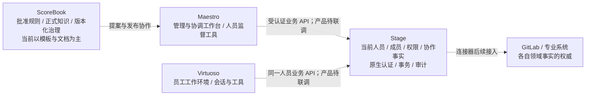
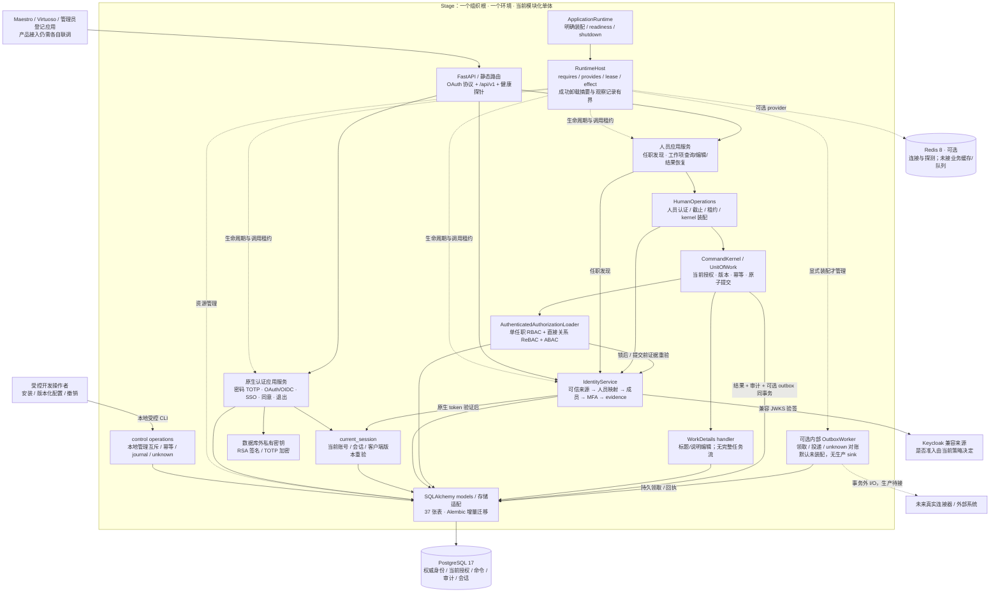
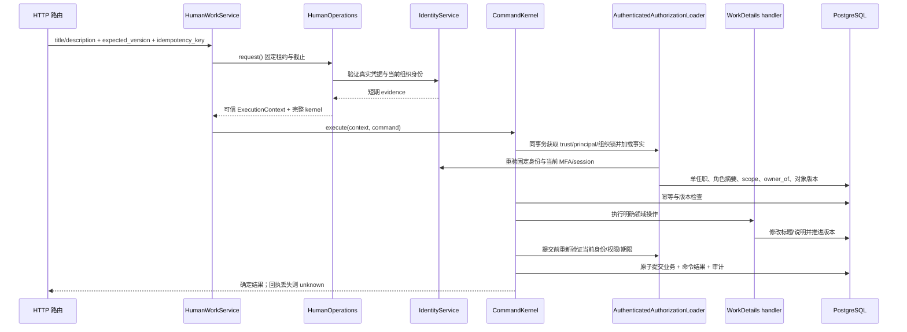

# Stage 架构全景、目录导航与函数职责

当前 Stage 是一个 **稳定基础协议之上的组件化模块单体**：FastAPI 提供静态 HTTP 接入，provider 管理应用服务和依赖租约，独立 Runtime Core 管理生命周期，身份/授权/命令协议约束业务，PostgreSQL 保存权威事实。它没有拆成微服务，也不是每个函数都做成插件。

本轮详细代码审计范围是这台云设备负责的 **Stage**。OrchestraCorp 四产品的角色也在下图列出，但没有把本地 Maestro 的研发或其他仓库做成已通过的代码审计。跨产品连线表示权威边界和预期接入，真实产品联调仍单独验收。

配套阅读：

- [并发优化实现复查](reviews/concurrency-optimization-2026-10-26.md)：当前组织准入门、S/X、同键恢复与实测边界。

- [P2/P3 整改与复查](reviews/p2p3-architecture-closeout-2026-10-26.md)：本轮逐项落实、验证与剩余边界。
- [详细审计报告](reviews/stage-engineering-audit-2026-10-26.md)：证据、问题分级、合理取舍与改进次序。
- [完整代码树与函数签名](stage-code-map.md)：108 个 app 模块、246 个类、637 个函数/方法定义，含内部与嵌套定义。
- [机器清单](reviews/stage-architecture-inventory-2026-10-26.json)：源码摘要、分层规模、导入、25 个 HTTP 操作和37 张物理表。
- [高分辨率架构图](diagrams/stage-panorama.svg)、[PNG](diagrams/stage-panorama.png)、[Mermaid 源码](diagrams/stage-panorama.mmd)。

## 1. OrchestraCorp 的产品边界



Stage 不收纳个人 Agent 会话作为默认企业事实，不把 OAuth scope/客户端 secret 变成人员岗位，也不替 ScoreBook 批准治理规则。用户、客户端、受控工具的责任区分继续遵循“人员—公司—人员”。

## 2. Stage 当前运行结构

<!-- panorama-diagram:start -->



<!-- panorama-diagram:end -->

实线是当前主要调用或数据流；虚线是生命周期管理或明确标注的待接入能力。所有 Python 组件都处于同一可信进程，组件隔离与调用 lease **不是安全沙箱**。图中的 `NATIVE` 是服务群简称，不代表 identity 调用完整登录流程。

默认组合是：database、配置了 URL 的 Redis、identity、明确 enabled 的 native-auth、assignments、human-work。通用 `command_plugin()` 和 `delivery_plugin()` 需要额外注入，不是已经启动的业务 Worker。Redis 当前只有连接与健康探测，没有实接的业务队列、缓存消费者或撤权权威。

## 3. 最需要理解的三条调用链

### 3.1 启动与资源归属

`create_app()` → lifespan → `ApplicationRuntime.start()` → `RuntimeHost.load()` → 各 provider 校验部署/依赖并 `provide()` → `await_ready()` → `/ready`。

调用通过 `context.call()` 固定依赖代次；组件停止先拒绝新调用并排空，再释放连接池、验证器与后台任务。资源关闭不会删除已经提交的数据库事实。成功卸载释放执行闭包与资源引用，只保留默认 256 条诊断摘要；失败和 blocked 所有权保留，观察记录也有容量与省略计数。

### 3.2 登录与权限是分开的

`authorize()` → `prepare_authorization()` → 浏览器 SSO 或 `password()`＋`otp()` → 同意 `advance()` → `finish_authorization_response()` → `exchange_code()`。

登录得到的 access token 经 `IdentityService.authenticate_human()` 再核对来源、映射、成员、组织 MFA，生成服务器内部 evidence。之后业务操作仍要求一个明确任职、当前角色版本和资源关系；不会从 token 内角色声明直接建立业务权限。

### 3.3 真实业务提交



现有编辑没有外部副作用，因此不生成 outbox；将来有外部投递时，先同事务写 outbox，再由独立 Worker 在事务外调用真实 sink。相同幂等键恢复结果仍重验当前读取权限。

## 4. 文件目录导航

```text
OrchestraCorp/
├── Stage/                          本轮详细审计对象：Python/FastAPI 后端
│   ├── app/
│   │   ├── main.py                 create_app；lifespan、路由与中间件
│   │   ├── bootstrap/              ApplicationRuntime；明确组件装配
│   │   ├── runtime/                纯进程内组件 Core
│   │   │   ├── host.py             Host/Context/Handle/CallScope 主状态机
│   │   │   ├── contracts.py        ServiceKey、PluginSpec、状态/报告
│   │   │   ├── effects.py          资源登记、准备、依赖顺序释放
│   │   │   ├── events.py           进程内五种分发方式
│   │   │   └── context.py/leases.py 稳定重导出入口，不是重复实现
│   │   ├── providers/              资源适配与应用编排，持有调用 lease
│   │   │   ├── storage.py          PG/Redis、schema 与健康探测
│   │   │   ├── identity.py         身份验证服务生命周期
│   │   │   ├── native_auth.py      发行器部署绑定与原生服务群
│   │   │   ├── assignments.py      本人任职发现
│   │   │   ├── human.py            HumanOperations 统一人员操作装配
│   │   │   ├── work.py             实际人员查询/编辑/结果恢复
│   │   │   └── execution.py        内部命令/投递工厂，默认未挂载
│   │   ├── api/                    HTTP 解析、DTO、错误、安全头和静态路由
│   │   │   ├── native_auth.py      原生认证路由组合与兼容导出
│   │   │   ├── native/             common/browser/logout/oauth/account 单一职责端点
│   │   │   ├── identity.py         本人身份
│   │   │   ├── assignments.py      本人任职列表
│   │   │   └── work.py             工作项读写与操作结果
│   │   ├── native_auth/            原生账号、协议与会话状态机
│   │   │   ├── credentials.py      密码/TOTP/恢复/重绑授权/凭据版本
│   │   │   ├── oauth.py            PKCE、token、refresh、UserInfo
│   │   │   ├── current_session.py  当前账号/会话事实重验
│   │   │   ├── protocol.py         OAuth 值对象、错误与范围合同
│   │   │   ├── browser.py          SSO 与用户同意
│   │   │   ├── logout.py           RP 退出确认及相关会话撤销
│   │   │   ├── sessions.py         本人会话/应用授权管理
│   │   │   ├── client_administration.py 多客户端管理和独立业务准入
│   │   │   ├── administration.py   显式绑定既有人员的本地账号
│   │   │   ├── crypto.py/keys.py   成熟密码学封装、私有文件、签名验证
│   │   │   └── config.py/freshness.py/redirects.py 发行与安全边界
│   │   ├── control/                本地受控管理事务、幂等日志、未知结果恢复
│   │   ├── identity/               当前身份、组织来源准入、成员与 MFA
│   │   ├── authz/                  当前单任职 RBAC/ReBAC/ABAC 和数据库 loader
│   │   ├── execution/              CommandKernel、UoW、幂等/审计/unknown
│   │   ├── delivery/               OutboxWorker 与 sink 协议，生产未接
│   │   ├── features/work/          唯一实接领域写入：details.py
│   │   ├── models/                 37 张物理表的映射
│   │   ├── storage/                UTC/精确字符串、组织S/X与幂等键协调
│   │   └── core/                   Settings、DB工厂、错误、中间件等框架辅助
│   ├── migrations/versions/        11 个增量迁移；head c6f3a19d820b
│   ├── contracts/openapi.yaml      25 个操作的机器合同
│   ├── scripts/                    dev/test 受控管理、冒烟与验收工具
│   ├── tests/                      领域/授权/并发/迁移/HTTP/浏览器测试
│   │   └── support/               共享 fixture、builder、时钟与 PG 观察助手
│   ├── deployment/                 当前开发设备与身份/OAuth手册
│   ├── docs/                       现行规格、设计、图、历史验收
│   ├── .github/workflows/ci.yml    GitHub 门禁；另有 .gitlab-ci.yml
│   └── pyproject.toml / uv.lock    Python 3.12、锁定依赖
├── Maestro/                        管理与协调端；本轮仅核对产品边界
├── Virtuoso/                       员工端；本轮仅核对产品边界
└── ScoreBook/                      治理/知识模板；本轮仅核对权威边界
```

目录内所有 Python 文件及其具体类/函数见[完整代码地图](stage-code-map.md)。本导航省略 `__init__.py`、小型 DTO 文件和测试明细以保持可读；没有把未列出的文件视为不存在。

`app/core` 并不是 `app/runtime`：前者是依赖框架/数据库的应用辅助，后者才是独立组件内核。`providers` 也不全是低层基础设施，它还承载了当前应用编排；这是后续可读性整理的重要命名点。

## 5. 主要函数及其功能

| 所在层/类 | 函数 | 功能与约束 |
|---|---|---|
| `main` / `ApplicationRuntime` | `create_app()`、`start()`、`close()` | 应用组装与生命周期，不是业务流程调度器 |
| `RuntimeHost` | `load()`、`call()`、`await_ready()`、`replace()`、`close()` | 发布/查找受管能力、等待就绪、控制换代与释放；动态 API 存在不等于产品已开放在线热插拔 |
| `ComponentContext` | `require()`、`provide()`、`effect()`、`spawn()`、`on_stop()` | 显式依赖与资源/任务归属；不是 Agent 会话上下文 |
| `EffectScope` / `EventBus` | `effect()/close()`；`emit/parallel/serial/bail/waterfall` | 进程内资源与组合事件，不能代替持久工作流 |
| `NativeCredentials` | `password()`、`otp()`、`recover()`、`reset_totp()`、`change_password()` | 验证真实因素、单次重绑证明、版本与会话失效，不生成业务权限 |
| `NativeOAuth` | `prepare_authorization()`、`finish_authorization_response()`、`exchange_code()`、`exchange_refresh()` | 客户端/回调/PKCE/同意、一次性消费、scope 缩权与限时发行 |
| `NativeOAuth` | `revoke()`、`userinfo()`、`authenticate_client()` | 单会话族撤销、按 scope 的身份投影和客户端认证 |
| `BrowserAuthorization` / `NativeLogout` | `resume()/advance()`；`prepare()/confirm()` | SSO/同意以及明确确认的 RP 退出，绑定当前浏览器与原认证时间 |
| `AccountSessions` | `list_sessions/revoke_session/revoke_all`、`list_consents/revoke_consent` | 只管理本人会话/授权，敏感操作取当前组织策略与 300 秒上限较短者 |
| `IdentityService` | `read_self()`、`authenticate_human()`、`acquire_human_locks()`、`validate_human()` | 验签之后核对当前来源/映射/成员/MFA，构造与重验可信 evidence |
| `DatabaseAuthorizationLoader` | `load()`、`load_role_version()`、`load_scope_chain()` | 从 DB 构造当前最小授权事实，限制为明确单任职 |
| `AuthorizationEngine` | `decide()` | 基于 action/关系/属性给出可解释判断，不执行 HTTP 或 SQL |
| `AuthenticatedAuthorizationLoader` | `acquire_locks()`、`load()`、`validate_before_commit()` | 把真实认证与当前业务授权连接到同一事务 |
| `CommandKernel` | `read()`、`execute()`、`get_result()`、`get_result_by_key()` | 受保护读取、受控写入、稳定幂等与当前权限下的结果恢复 |
| `UnitOfWork` | `managed_uow()`、`assert_owned()`、`flush()` | 保留单一事务提交者，防止可信 handler 意外提前提交 |
| `HumanOperations` | `request()`；`create_human_kernel()` | 统一真实人员认证、截止、租约、上下文与完整身份重验装配 |
| `control.operations` | `operation_transaction()`、`find_replay()`、`append_journal()`、`operation_result()` | 共享本地管理协议，保持既有日志身份和 unknown 恢复 |
| `current_session` | `validate_native_session()`、`validate_browser_session()` | 在调用方已经取得的锁域内复核当前账号/会话事实 |
| `HumanWorkService` | `get_item()`、`update_details()`、`get_operation()` | 当前公开人员业务编排；查询也在返回前重新检查期限 |
| `features/work/details` | `update_work_details()` / `WORK_DETAILS_COMMAND` | 修改已有 work item 的标题/说明；不支持任务领取、交付、批准 |
| `OutboxWorker` | `run_once()`、`reconcile_one()`、`retry_blocked()`、`close()` | 显式装配后领取/投递/对账；没有默认生产连接器 |
| 受控管理函数 | `bootstrap()`、`install_authorization()`、`configure_human_authentication()`、`configure_client()`、`admit_client()` | 显式版本化安装或撤销；业务 source admission 与 OAuth client 登记分开 |

## 6. 存储事实为什么是 37 张

| 分组 | 张数 | 保存什么 |
|---|---:|---|
| 身份/组织基础 | 12 | Principal、组织/成员经历、来源/trust/profile、MFA、workload、bootstrap/journal |
| 当前授权 | 8 | action、角色定义/版本/动作、scope/resource、任职与直接关系 |
| 业务执行/投递 | 5 | 组织 guard、命令结果、审计、outbox、投递 attempt |
| 最小业务事实 | 1 | work_item |
| 原生认证/OAuth | 11 | 账号/客户端、登录请求、RP/浏览器会话、同意、退出请求、code/refresh、安全事件/限流 |

这些表不表示完整 OA 或完整 IAM 已交付。认证与安全基础在当前代码中占比很高，领域业务仍只有一条最小闭环；下一轮应优先证明新增业务的成本，而不是继续增加尚无真实调用者的抽象。
